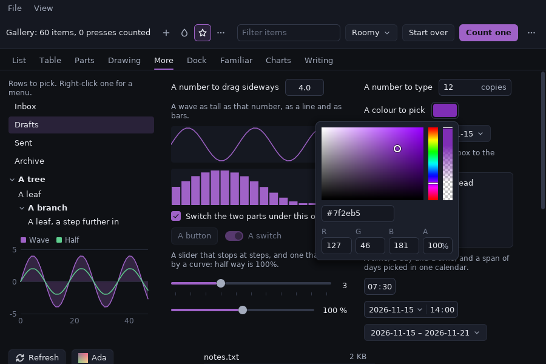

# taut

A GUI library for Rust on Windows and Linux with no dependencies: no crates, no graphics card,
no web view. One function describes the window from the app's state; the library draws only
what changed, and nothing while nothing happens.

| Windows 11 | Linux (X11) |
| --- | --- |
|  |  |

## A first program

```toml
[dependencies]
taut = "0.1"
```

```rust,no_run
use taut::Window;

fn main() {
    let mut presses = 0;
    let window = Window { title: "Hello", width: 320.0, height: 160.0, ..Default::default() };
    taut::run(window, move |ui| {
        ui.column().pad(16.0).gap(10.0).open();
        ui.label(&format!("Pressed {presses} times"));
        presses += ui.button("Press").clicked as u32;
        ui.close();
    });
}
```

The function runs when something happens. Open a box, describe its content, close it. A part
takes `&mut` to what it changes and returns what the user did.

## Why taut

- **Small:** the program above is 457 KB on Windows, 758 KB on Linux (iced 5.9 MB, Slint 7.8 MB,
  egui 8.3 MB). Only the parts called are compiled in.
- **No dependencies:** 0 crates (iced 159, egui 179, Slint 245). No GPU needed.
- **Fast:** a 1,000-row window is described and redrawn in 172 µs (one frame: Dear ImGui 244 µs,
  egui 6,114 µs). Idle costs nothing.
- **Accessible:** full keyboard use; screen readers through UI Automation and AT-SPI.
- **Tested:** over 1,100 tests on Windows 11, Ubuntu and Arch Linux; every interface test checks
  partial against full redraw, pixel for pixel; every parser of outside data is fuzzed.

## At a glance

- **Systems:** Windows; Linux on X11 or Wayland. Not macOS, iOS, Android or the web yet.
- **Rust:** 1.88+. **Licence:** MIT or Apache-2.0.
- **Features** (all off by default): `right-to-left`, `brahmic`, `emoji`, `fallback-fonts`,
  `touch`, `cff`, `woff2`, `color-profiles` ([costs](docs/costs-and-speed.md#what-it-costs)).
- **State:** 0.1. Names may change before 1.0 ([changes](CHANGELOG.md),
  [what is missing](docs/what-is-missing.md)).

## Examples

`cargo run --example <name>`:

| Example | What it is |
| --- | --- |
| `hello` | the program above |
| `gallery` | most parts, on nine pages (the pictures above) |
| `todo` | a to-do list kept in a file (built in chapter 4 of the book) |
| `files` | a file browser: folder tree, sortable table |
| `editor` | a text editor: tabs, find and replace, menus |
| `settings` | a settings window that follows the system's light or dark |
| `chat` | a message list that stays at its end |
| `viewer` | a viewer for PNG, JPEG, GIF, WebP, BMP, ICO and SVG |
| `dashboard` | tiles, live charts, a table |
| `nodes` | a node editor on a pan-and-zoom board |
| `report` | a chart and text, saved as PDF or printed |
| `tray` | a tray icon, notifications, a global hotkey |
| `desktop` | a whole desktop drawn into a pixel buffer |
| `picture` | an interface drawn into a PNG, no window |
| `d3d11`, `opengl`, `vulkan` | the interface over the program's own renderer |
| `overlay` | the library in a DLL with a C interface |
| `bench` | the [timings](docs/costs-and-speed.md#how-fast-it-is) |

`book`, `walk` and `walk_reader` are the library's own tools (book pictures, demo measurements).

## Beside other Rust libraries

A label and a button, built for size on Windows, 2026-11-15:

| | taut | egui | iced | Slint |
| --- | --- | --- | --- | --- |
| Program | 457 KB | 8.3 MB | 5.9 MB | 7.8 MB |
| Other crates | 0 | 179 | 159 | 245 |
| Drawn by | CPU | GPU | GPU, or CPU | GPU, or CPU |
| Screen readers | own (UI Automation, AT-SPI) | AccessKit | none in 0.14 | AccessKit |

[More libraries, and Dear ImGui part by part](docs/beside-other-libraries.md).

## Documentation

- **Start:** [a first window](docs/01-a-first-window.md), then [the book](docs/README.md#the-book)
  (ten chapters).
- **Reference:** [the guide](GUIDE.md) (every call on one page) and [the API](https://docs.rs/taut).
- **Details:** [what is in it](docs/what-is-in-it.md), [what is missing](docs/what-is-missing.md),
  [costs and speed](docs/costs-and-speed.md), [testing](docs/how-it-is-tested.md),
  [inside other programs](docs/inside-other-programs.md),
  [other libraries](docs/beside-other-libraries.md).
- **Project:** [changes](CHANGELOG.md), [design goals](GOALS.md).

## Licence

MIT or Apache-2.0, at your option ([LICENSE-MIT](LICENSE-MIT), [LICENSE-APACHE](LICENSE-APACHE)).
Unicode, HarfBuzz and Brotli data: [THIRD-PARTY.md](THIRD-PARTY.md).

Contributions are taken under the same terms, unless you state otherwise.
