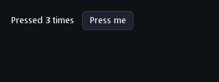
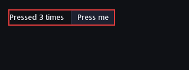

# 1. A first window

A window with a button, and what happens inside when it is pressed.

## Setup

Rust 1.88 or newer:

```toml
[dependencies]
taut = "0.1"
```

No other crates. On Linux, FreeType, Fontconfig, and libX11 or libxkbcommon are loaded at run
time; nothing is linked. Features for extra scripts, emoji and touch: chapter 6.

Debug builds are slow at heavy work (a 73-page PDF: 15 s debug, 0.6 s release). Optimize just
the library:

```toml
[profile.dev.package.taut]
opt-level = 3
```

## Terms

| taut | Usual term |
| --- | --- |
| part (`ui.button`) | widget, control |
| box (`ui.row()`, `ui.el()`) | container, element |
| unit | logical pixel (one pixel at 100% scale) |
| run | frame: one call of the describe function |
| note, notice, fold | secondary text, toast, collapsing header |
| tick box, choice | checkbox, radio button |
| tell (`ui.tell`) | give screen readers a part's role, name and state |

The [guide](../GUIDE.md) lists the rest.

## The program

```rust,no_run
use taut::{Ui, Window};

struct App {
    count: u32,
}

fn describe(app: &mut App, ui: &mut Ui) {
    ui.row().pad(16.0).gap(12.0).open();
    ui.label(&format!("Pressed {} times", app.count));
    if ui.button("Press me").clicked {
        app.count += 1;
    }
    ui.close();
}

fn main() {
    let mut app = App { count: 0 };
    taut::run(Window { title: "A first window", width: 320.0, height: 120.0, ..Default::default() }, move |ui| describe(&mut app, ui));
}
```

After three presses:



- **State:** `App`, a plain struct the library never sees.
- **A describe function:** says what the window shows now, top to bottom.
- **`taut::run`:** opens the window, calls the function when something happens, returns when it
  closes.

```text
ui.row()                a box whose children go left to right
    .pad(16.0)          16 units of room inside its edge
    .gap(12.0)          12 between children
    .open();            add it; what follows goes inside
ui.label(..)            first child
ui.button(..)           second child
ui.close();             the row ends
```

No closures, no nesting. `ui.button(..)` adds a button and returns a `Response`; `clicked` is
true in the run that sees the click.

## What happens

1. **Open:** `describe` records boxes in a list; the library lays them out and draws.
2. **Idle:** no loop runs; no CPU is used.
3. **Pointer over empty room:** nothing new under it, so `describe` isn't called.
4. **Pointer onto the button:** `describe` runs; only the button differs, so only it redraws.
5. **Click:** `clicked` is true and the count goes up, but the label was already described, so
   the library reruns `describe` before drawing.
6. **Redraw:** only the label and button (in red):



Describing everything again keeps the window in step with the data, and is cheap: 7,000 boxes in
about 160 µs ([benchmarks](costs-and-speed.md#how-fast-it-is)); an unchanged layout isn't redone;
a pointer move over the same box costs about 12 ns. The same program by hand, with no window
(chapter 8):

```rust
use taut::geom::{Size, pt};
use taut::text::BuiltInFont;
use taut::{Event, LocalClipboard, Rect, Ui};

fn describe(count: &mut u32, ui: &mut Ui) {
    ui.row().pad(16.0).gap(12.0).open();
    ui.label(&format!("Pressed {count} times"));
    if ui.button("Press me").clicked {
        *count += 1;
    }
    ui.close();
}

let mut ui = Ui::new(Box::new(BuiltInFont), Box::new(LocalClipboard::default()));
ui.resize(Size { w: 320.0, h: 120.0 }, 1.0);
let mut count = 0;

// The first run: everything is new, so all of the window is to be drawn.
let changed = ui.run(&mut |ui| describe(&mut count, ui));
assert_eq!(changed, Rect { x: 0.0, y: 0.0, w: 320.0, h: 120.0 });

// A run in which nothing happened: nothing differs, so nothing is to be drawn.
assert_eq!(ui.run(&mut |ui| describe(&mut count, ui)), Rect::EMPTY);

// The pointer moves over empty room: the library says there is no need to run at all.
assert!(!ui.event(Event::Move(pt(300.0, 100.0))));
```

## The window

| `Window` field | Meaning |
| --- | --- |
| `title` | Title text (`ui.set_title(..)` changes it) |
| `width`, `height` | Inner size, in units |
| `min_width`, `min_height` | Smallest size |
| `at` | Top-left on screen (default: the system's choice) |
| `screen` | Screen to open centred on |
| `maximized`, `minimized` | Initial state |
| `icons` | The program's icon |
| `bare`, `clear` | No frame; transparent (guide: "Kinds of window") |

- One unit is one pixel at 100%; at 150% everything is drawn 1.5× larger.
- The close button or `ui.quit()` ends `taut::run`.
- To hide the console on Windows, add this at the top of `main.rs` (keep the console while
  developing):

```rust,no_run
#![windows_subsystem = "windows"]
```

- Dark by default; `ui.theme` is a plain struct (chapter 7 follows the system's setting):

```rust
use taut::{Theme, Ui};

fn describe(ui: &mut Ui) {
    ui.theme = Theme::light();
    ui.theme.accent = taut::Color::rgb(0x1a8f52);
    ui.label("Dark text on a light ground, with a green that stands out");
}
```

## Summary

- The app keeps its state; one function describes the window from it.
- Open a box, fill it, close it. A part is one call and returns what the user did.
- The function runs only when something happens; only changes are redrawn.

Next: [boxes and layout](02-boxes-and-layout.md).
