# 2. Boxes and layout

Everything is a box: a button is a box with text, a row a box of boxes, the window a column.
Each picture is drawn by the code above it.

## A box

`ui.el()` starts a box; each call sets one property; the last adds it:

- `.open()`: what follows goes inside, until `ui.close()`.
- `.show()`: nothing inside but its own text, icon or picture.

`ui.row()`, `ui.column()`, `ui.grid(columns)` and `ui.wrapping_row()` are `ui.el()` with presets.
Ready-made parts are built from the same boxes.

## Rows and columns

```rust
use taut::Ui;

fn describe(ui: &mut Ui) {
    ui.row().pad(12.0).gap(8.0).open();
    ui.button("One");
    ui.button("Two");
    ui.button("Three");
    ui.close();
}
```

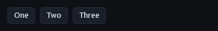

```rust
use taut::Ui;

fn describe(ui: &mut Ui) {
    ui.column().pad(12.0).gap(8.0).open();
    ui.button("One");
    ui.button("Two");
    ui.button("Three");
    ui.close();
}
```

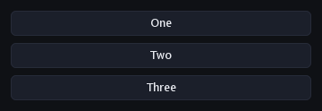

A column stretches its children across; a row centres them vertically. `pad` is room inside the
edge (one value, `(x, y)` or `(left, top, right, bottom)`); `gap` is room between children.

## Size

Each axis is a `Length`: `Fit` (content size, the default), `Px(units)`, or `Grow(weight)` (a
share of the leftover). `.w(..)`, `.h(..)`, `.size(w, h)`, `.grow()` (both ways).

```rust
use taut::{Length, Ui};

fn describe(ui: &mut Ui) {
    let t = ui.theme;
    ui.row().pad(12.0).gap(8.0).open();
    ui.el().text("Fit", t.font, t.text).pad(8.0).fill(t.raise).border(t.line_strong, 1.0).show();
    ui.el().w(Length::Px(120.0)).text("Px(120.0)", t.font, t.text).pad(8.0).fill(t.raise).border(t.line_strong, 1.0).show();
    ui.el().w(Length::Grow(1.0)).text("Grow(1.0)", t.font, t.text).pad(8.0).fill(t.raise).border(t.line_strong, 1.0).show();
    ui.close();
}
```

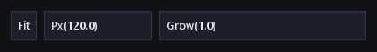

`let t = ui.theme;` copies the theme: a box being described borrows `ui` until added, so this
doesn't compile:

```rust,compile_fail,E0503
fn describe(ui: &mut taut::Ui) {
    ui.el().text("Fit", ui.theme.font, ui.theme.text).show();
}
```

`Grow(2.0)` gets twice `Grow(1.0)`. `ui.spacer()` is an empty growing box that pushes what
follows to the end:

```rust
use taut::{Length, Ui};

fn describe(ui: &mut Ui) {
    let t = ui.theme;
    ui.column().pad(12.0).gap(8.0).open();
    ui.row().gap(8.0).open();
    ui.el().w(Length::Grow(1.0)).text("Grow(1.0)", t.font, t.text).pad(8.0).fill(t.raise).border(t.line_strong, 1.0).show();
    ui.el().w(Length::Grow(2.0)).text("Grow(2.0)", t.font, t.text).pad(8.0).fill(t.raise).border(t.line_strong, 1.0).show();
    ui.close();
    ui.row().gap(8.0).open();
    ui.button("Back");
    ui.spacer();
    ui.button("Cancel");
    ui.primary_button("Save");
    ui.close();
    ui.close();
}
```

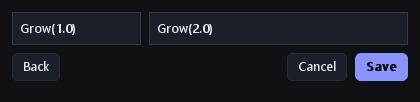

On the cross axis, `Grow` takes all the room. `.min(w, h)` and `.max(w, h)` clamp;
`.min(0.0, 200.0)` sets only a minimum height.

## Alignment

`.align(along, across)` places children in spare room: `Start`, `Center`, `End`, or `Spread`
(along: room between children; across: stretch).

```rust
use taut::{Align, Length, Ui};

fn describe(ui: &mut Ui) {
    let t = ui.theme;
    ui.column().pad(12.0).gap(8.0).open();
    for (name, along) in [("Start", Align::Start), ("Center", Align::Center), ("End", Align::End), ("Spread", Align::Spread)] {
        ui.row().h(Length::Px(40.0)).pad(4.0).gap(4.0).align(along, Align::Center).fill(t.panel).border(t.line, 1.0).open();
        ui.button(name);
        ui.button("and");
        ui.button("more");
        ui.close();
    }
    ui.close();
}
```

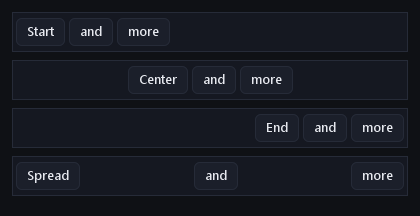

`ui.row()` is `.align(Align::Start, Align::Center)`; `ui.column()` is
`.align(Align::Start, Align::Spread)`.

## Placing one box

`.place(..)` overrides the cross-axis alignment for one child; a pair sets each axis, horizontal
first.

```rust
use taut::{Align, Length, Ui};

fn describe(ui: &mut Ui) {
    let t = ui.theme;
    ui.column().pad(12.0).gap(8.0).open();
    ui.button("Stretched across, as a column has its boxes");
    ui.el().place(Align::End).text("At the end", t.font, t.text).pad(8.0).fill(t.raise).border(t.line_strong, 1.0).show();
    ui.row().h(Length::Px(56.0)).gap(8.0).fill(t.panel).border(t.line, 1.0).open();
    ui.button("In the middle of the height");
    ui.el().place(Align::Start).text("At the top", t.font, t.text).pad(8.0).fill(t.raise).border(t.line_strong, 1.0).show();
    ui.close();
    ui.close();
}
```

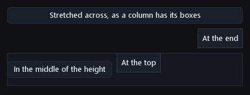

`.at(x, y)` offsets a box without moving its siblings; in layers it places a box anywhere.

## Grids

`ui.grid(columns)` fills columns row by row; a column is as wide as its widest box, a row as high
as its tallest:

```rust
use taut::{Align, Ui};

struct Form {
    name: String,
    place: String,
    rows: usize,
}

fn describe(form: &mut Form, ui: &mut Ui) {
    ui.grid(2).pad(12.0).gap(8.0).align(Align::Start, Align::Center).open();
    ui.label("Name");
    ui.text_box(&mut form.name, "Your name");
    ui.label("Where it is kept");
    ui.text_box(&mut form.place, "A folder");
    ui.label("Rows");
    ui.select(&mut form.rows, &["Roomy", "Tight"]);
    ui.close();
}
```

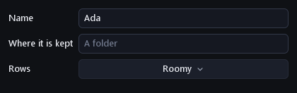

- Parts stretch to their column unless sized in units; `ui.number` and the colour button keep
  their size; growing parts (text boxes, sliders, progress bars) widen their column to the
  grid's full room.
- Vertically, a box keeps its height and follows the grid's `align`.
- `.gap(8.0)` spaces columns and rows; `.line_gap(12.0)` spaces rows separately.

## Wrapping rows

`ui.wrapping_row()` continues on the next line when out of width (tags, toolbars, thumbnails).
`.line_gap(..)` spaces the lines. In a row, give it a width or let it grow.

```rust
use taut::Ui;

fn describe(ui: &mut Ui) {
    let t = ui.theme;
    ui.wrapping_row().pad(12.0).gap(6.0).open();
    for tag in ["layout", "drawing", "text", "tables", "menus", "docks", "scenes", "screen readers", "fonts", "pictures"] {
        ui.el().text(tag, t.small, t.text_dim).pad((8.0, 3.0)).fill(t.raise).border(t.line, 1.0).radius(10.0).show();
    }
    ui.close();
}
```

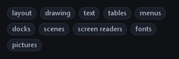

Text wraps with `.wrap()`; `ui.paragraph(..)` is wrapping text.

## Too little room

Boxes marked `.gives_way(n)` shrink (to their `min`) when a row is short of room, their text
ending in "…"; higher numbers give first, equal numbers share:

```rust
use taut::{Length, Ui};

fn file(ui: &mut Ui, name: &str, folder: &str) {
    let t = ui.theme;
    ui.row().gap(8.0).pad((10.0, 6.0)).fill(t.panel).radius(6.0).open();
    ui.el().text(name, t.font, t.text).gives_way(1).show();
    ui.el().text(folder, t.small, t.text_dim).gives_way(2).show();
    ui.spacer();
    ui.button("Open");
    ui.close();
}

fn describe(ui: &mut Ui) {
    ui.column().pad(12.0).gap(8.0).open();
    for width in [420.0, 300.0, 200.0] {
        ui.column().w(Length::Px(width)).open();
        file(ui, "a report with a long name.txt", "D:\\Work\\Reports\\2026\\November");
        ui.close();
    }
    ui.close();
}
```

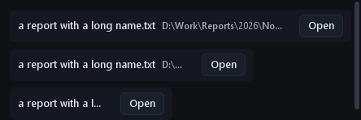

In a column, height gives way. `.narrows(1)` gives way in rows only (tick boxes use it, wrapping
their words). `.clip()` cuts overflow without shrinking.

## Scrolling

`.scroll()` scrolls vertically (wheel, bar, Page Up/Down, Home, End); `.scroll_x()` sideways. The
bar never covers content. A first child marked `.kept()` stays at the top; a last, at the bottom.

```rust
use taut::{Length, Ui};

fn describe(ui: &mut Ui) {
    let t = ui.theme;
    ui.column().h(Length::Px(160.0)).scroll().pad(12.0).gap(4.0).open();
    ui.el().text("Kept at the top", t.font.bold(), t.text).pad((0.0, 4.0)).fill(t.bg).kept().show();
    for row in 1..=30 {
        ui.row().pad((10.0, 6.0)).fill(t.panel).radius(4.0).open();
        ui.label(&format!("Row {row}"));
        ui.close();
    }
    ui.close();
}
```

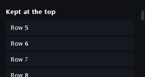

- With no height set, a scroll box takes the height it is given.
- The library keeps scroll offsets (chapter 3 covers lists that change).
- `.sticky()` headings stay at the top until their group ends or the next one pushes them; give
  each group its own box, heading first.
- For thousands of rows, `ui.rows` describes only visible ones (chapter 5).

## Layers

`.flow(Flow::Layers)` stacks children; place each with `.place(..)` and `.at(x, y)`. Later boxes
lie on top.

```rust
use taut::{Align, Flow, Length, Ui};

fn describe(ui: &mut Ui) {
    let t = ui.theme;
    ui.row().pad(16.0).open();
    ui.el().flow(Flow::Layers).size(220.0, 90.0).open();
    ui.column().grow().pad(12.0).gap(4.0).fill(t.panel).border(t.line, 1.0).radius(8.0).open();
    ui.text("Inbox", t.font.bold(), t.text);
    ui.note("Everything that came today");
    ui.close();
    ui.el().place((Align::End, Align::Start)).at(6.0, -6.0).text("12", t.small, t.on_accent).pad((7.0, 2.0)).fill(t.red).radius(9.0).show();
    ui.el().place(Align::End).h(Length::Px(4.0)).w(Length::Px(60.0)).at(-12.0, -12.0).fill(t.accent).radius(2.0).show();
    ui.close();
    ui.close();
}
```

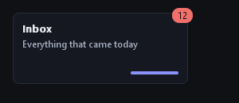

## Looks

| Call | Effect |
| --- | --- |
| `.fill(color)`, `.border(color, width)`, `.radius(r)`, `.shadow(reach)` | background, inner border, rounded corners, soft shadow |
| `.gradient(top, bottom)`, `.gradient_across(..)`, `.gradient_along(degrees, &stops)`, `.gradient_around(&stops)` | gradients |
| `.text(text, font, color)`, `.wrap()`, `.text_align(..)` | text |
| `.icon(..)`, `.picture(..)`, `.drawing(..)`, `.shape(..)`, `.outline(..)` | pictures and shapes (chapter 6) |

Theme colours (`t.panel`, `t.raise`, `t.line`, `t.text_dim`) match the ready-made parts in dark
and light.

## How layout works

Boxes are one flat list, parents first. Layout is four passes, each touching every box once:
widths up, widths down, text wrapping, heights both ways. Everything layout reads is hashed while
describing; if the hash is unchanged, the old layout is reused. Hover and scrolling never
re-lay out.

## Summary

- `row`, `column`, `grid`, `wrapping_row` lay out; `Fit`, `Px`, `Grow` size.
- `pad`, `gap`, `align`, `place` position; `spacer` pushes apart; `gives_way` shrinks.
- `scroll` holds more than fits; `Flow::Layers` stacks.

Next: [parts and state](03-parts-and-state.md).
