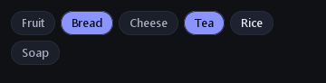

# 3. Parts and state

The app keeps everything that means something to it; the library keeps only what must outlast a
run and means nothing to the app.

## What the app keeps

A part is handed the value it changes; the library holds no copy:

```rust
use taut::Ui;

struct Settings {
    name: String,
    loud: bool,
    volume: f32,
    size: usize,
}

fn describe(settings: &mut Settings, ui: &mut Ui) {
    ui.column().pad(12.0).gap(8.0).open();
    ui.text_box(&mut settings.name, "Your name");
    ui.checkbox(&mut settings.loud, "Loud");
    ui.slider(&mut settings.volume, 0.0..=10.0);
    ui.select(&mut settings.size, &["Small", "Middle", "Large"]);
    ui.close();
}
```

Larger parts take library values the app keeps: `Table`, `Panel`, `Dock`, `SecondWindow`, `Selection`,
`FileDialog`. `Table`, `Panel`, `Dock` and `SecondWindow` round-trip through one line of text
(`to_string()`, `parse()`).

## What the library keeps

Scroll offsets; the text cursor, selection and undo; focus, hover and the pressed box; open menus;
running animations and notices; pictures, drawings and meshes until released. All stored under
the id of their box.

## Ids and keys

A box's id comes from its parent's id and its position among siblings. In a list that changes,
removing the first item hands its id, and its state, to the next. Here the user types in the
second of three boxes when the first is removed; the letter lands in the wrong box:

```rust
use taut::geom::Size;
use taut::text::BuiltInFont;
use taut::{Event, LocalClipboard, Ui};

struct Item {
    id: u32,
    text: String,
}

fn rows(items: &mut [Item], keyed: bool, boxes: &mut Vec<u64>, ui: &mut Ui) {
    boxes.clear();
    for item in items.iter_mut() {
        match keyed {
            true => ui.row().key(item.id).open(),
            false => ui.row().open(),
        };
        boxes.push(ui.text_box(&mut item.text, "").id);
        ui.close();
    }
}

fn typed_after_the_first_goes(keyed: bool) -> Vec<String> {
    let mut ui = Ui::new(Box::new(BuiltInFont), Box::new(LocalClipboard::default()));
    ui.resize(Size { w: 300.0, h: 200.0 }, 1.0);
    let mut items: Vec<Item> = ["a", "b", "c"].iter().zip(1..).map(|(text, id)| Item { id, text: text.to_string() }).collect();
    let mut boxes = Vec::new();
    ui.run(&mut |ui| rows(&mut items, keyed, &mut boxes, ui));
    // The keyboard goes into the second box, "b".
    ui.set_focus(boxes[1]);
    ui.run(&mut |ui| rows(&mut items, keyed, &mut boxes, ui));
    // The first item goes, and the person types an "X".
    items.remove(0);
    ui.run(&mut |ui| rows(&mut items, keyed, &mut boxes, ui));
    ui.event(Event::Text("X".into()));
    ui.run(&mut |ui| rows(&mut items, keyed, &mut boxes, ui));
    items.into_iter().map(|item| item.text).collect()
}

// Known by their places, the boxes swap items: the "X" goes into "c".
assert_eq!(typed_after_the_first_goes(false), ["b", "cX"]);
// Known by the items' own ids, the keyboard stays with "b".
assert_eq!(typed_after_the_first_goes(true), ["bX", "c"]);
```

`.key(..)` fixes it: a keyed box is known by its key. Use the item's own stable id, not its
index.

- Key rows of lists whose items are added, removed or reordered. Keys are unique among siblings.
- `ui.selectable_row(key, ..)` takes its key directly.
- `ui.rows` and `ui.list` number rows from the first overall, so scrolling keeps row state.
- `ui.id(key)` and `ui.next_id()` give an id before the box exists.

## Response

| Field | Meaning |
| --- | --- |
| `clicked` | Pressed and released on it this run; Enter and Space click the focused part. |
| `changed` | The user changed its value. |
| `hovered` | Pointer over it, and over nothing on top of it. |
| `contains_pointer` | Pointer over it or over something inside it. |
| `pressed` | Left button went down on it and is still down. |
| `right_clicked`, `double_clicked` | As named. |
| `focused` | It has keyboard focus. |
| `rect` | Its place at the last layout, in units. |
| `id` | Its id. |

Custom boxes opt in with `.sense()` and `.focusable()`. Answers come from the last layout (where
the user saw the box), so they are known as soon as the box is described.

## A custom part

A function that builds boxes and returns what the user did:

```rust
use taut::{Cursor, Response, Role, Ui};

/// A small rounded word that is on or off: a tag to pick.
fn chip(ui: &mut Ui, on: &mut bool, name: &str) -> Response {
    let t = ui.theme;
    let mut state = ui.press(ui.next_id());
    if state.clicked {
        (*on, state.changed) = (!*on, true);
    }
    if state.hovered {
        ui.set_cursor(Cursor::Hand);
    }
    let (fill, ink) = match (*on, state.hovered) {
        (true, _) => (t.accent, t.on_accent),
        (false, true) => (t.hover, t.text),
        (false, false) => (t.raised, t.text_dim),
    };
    ui.el().text(name, t.font, ink).pad((12.0, 5.0)).fill(fill).border(t.line, 1.0).radius(14.0).sense().focusable().show();
    ui.tell(&state, Role::CheckBox, Some(*on), "");
    state
}

struct Shopping {
    wanted: [bool; 6],
}

fn describe(shopping: &mut Shopping, ui: &mut Ui) {
    ui.wrapping_row().pad(12.0).gap(6.0).open();
    for (on, name) in shopping.wanted.iter_mut().zip(["Fruit", "Bread", "Cheese", "Tea", "Rice", "Soap"]) {
        chip(ui, on, name);
    }
    ui.close();
}
```



1. `ui.press(ui.next_id())` asks about the box before it exists, since its look depends on the
   answer (`press` is `ui.interact` plus Enter and Space).
2. A click flips the value and sets `changed`.
3. The box is described with `.sense().focusable()`.
4. `ui.tell` gives screen readers its role and state (chapter 7).

If the look doesn't depend on the answer, use the `Response` of `show()` or `open()`:

```rust
use taut::Ui;

fn card(ui: &mut Ui, title: &str) -> bool {
    let t = ui.theme;
    let card = ui.column().pad(12.0).gap(4.0).fill(t.panel).radius(8.0).sense().open();
    ui.text(title, t.font.bold(), t.text);
    ui.note("Press anywhere on the card");
    ui.close();
    card.clicked
}
```

## Opening and closing

| Part | Close it |
| --- | --- |
| `ui.menu(..)`, `ui.menu_button(..)`, `ui.submenu(..)`, `ui.context_menu(..)`, `ui.popup(..)`, `ui.popover(..)`, `ui.panel(..)`, `ui.window(..)`, `ui.frameless_window(..)`, `ui.docked(..)`, `ui.docked_closable(..)`, `ui.drag_source(..)` | when it returns `true` |
| `ui.tree(&mut open, ..)`, `ui.selectable_tree(&mut open, ..)` | when `open` is true after it |
| `ui.graph(..)` | after each node it yields |
| `ui.menu_bar()`, `ui.tool_bar()`, `ui.dialog()`, `ui.card()`, `ui.banner(..)`, `ui.dock(..)`, `ui.pan_zoom(..)`, `ui.table(..)`, `ui.rows(..)`, `ui.list(..)`, `ui.variable_rows(..)`, `ui.tree_view(..)`, `ui.tree_row(..)`, `ui.selectable_row(..)`, `ui.notices(..)` | always |

In debug builds an unbalanced run panics, naming the line that opened the unclosed box, or the
`ui.close()` with nothing to close.

## Late changes

State changed after the boxes showing it were described shows late. After a click, a consumed
key (`ui.key`, `ui.keys`) or a part's change, the library reruns `describe` once before drawing.
For anything else (say, a message from another thread read mid-run), call `ui.rerun()`:

```rust
use std::sync::mpsc::{Receiver, channel};
use taut::geom::Size;
use taut::text::BuiltInFont;
use taut::{Event, Key, LocalClipboard, Mods, Ui};

fn describe(count: &mut u32, news: &Receiver<u32>, rerun: bool, shown: &mut String, ui: &mut Ui) {
    *shown = format!("{count} new");
    ui.label(shown);
    // A key asked for after the label: the label is described once more by itself, with
    // the new count.
    if ui.keys("Ctrl+N") {
        *count += 1;
    }
    // News taken after the label: of that the library knows nothing.
    if let Ok(more) = news.try_recv() {
        *count += more;
        if rerun {
            ui.rerun();
        }
    }
}

fn labels(rerun: bool) -> [String; 2] {
    let mut ui = Ui::new(Box::new(BuiltInFont), Box::new(LocalClipboard::default()));
    ui.resize(Size { w: 300.0, h: 100.0 }, 1.0);
    let (mut count, mut shown, (send, news)) = (0, String::new(), channel());
    ui.run(&mut |ui| describe(&mut count, &news, rerun, &mut shown, ui));
    ui.event(Event::Key(Key::Char('n'), Mods::CTRL));
    ui.run(&mut |ui| describe(&mut count, &news, rerun, &mut shown, ui));
    let after_the_key = shown.clone();
    send.send(5).unwrap();
    ui.run(&mut |ui| describe(&mut count, &news, rerun, &mut shown, ui));
    [after_the_key, shown]
}

// The key shows at once either way. Without `rerun`, the window goes on showing "1 new"
// after five more came, until something else happens.
assert_eq!(labels(false), ["1 new", "1 new"]);
assert_eq!(labels(true), ["1 new", "6 new"]);
```

From outside the window:

- `ui.wake_after(duration)`: run again later.
- `taut::Waker.wake()`: run soon, from any thread.
- `ui.animate(id, target, duration)`: an animated value.

```rust,no_run
use std::sync::mpsc::{Receiver, channel};
use taut::{Ui, Window};

struct App {
    answers: Receiver<String>,
    last: String,
}

fn describe(app: &mut App, ui: &mut Ui) {
    // What the other thread found, since the last run.
    while let Ok(answer) = app.answers.try_recv() {
        app.last = answer;
    }
    ui.label(&app.last);
}

fn main() {
    let (send, answers) = channel();
    std::thread::spawn(move || {
        for second in 1.. {
            std::thread::sleep(std::time::Duration::from_secs(1));
            let _ = send.send(format!("{second} seconds have gone by"));
            taut::Waker.wake();
        }
    });
    let mut app = App { answers, last: String::new() };
    taut::run(Window { title: "Woken", ..Default::default() }, move |ui| describe(&mut app, ui));
}
```

## Disabled parts

`ui.set_enabled(false)` disables what follows until `ui.set_enabled(true)`: paler, no input, no
Tab stop.

```rust
use taut::Ui;

fn describe(signed_in: bool, ui: &mut Ui) {
    ui.set_enabled(signed_in);
    ui.button("Send");
    ui.button("Delete");
    ui.set_enabled(true);
}
```

## Summary

1. State is the app's; a part takes what it changes and returns what the user did.
2. Close what you open.
3. Key rows of changing lists with the item's id.
4. Call `ui.rerun()` for late changes not caused by a click, key or part.

Next: [a real small app](04-a-real-small-app.md).
