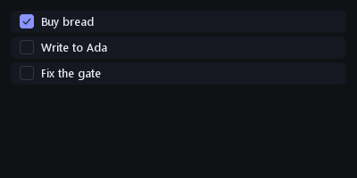
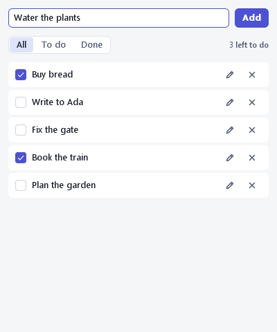
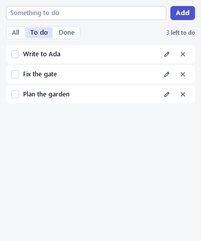
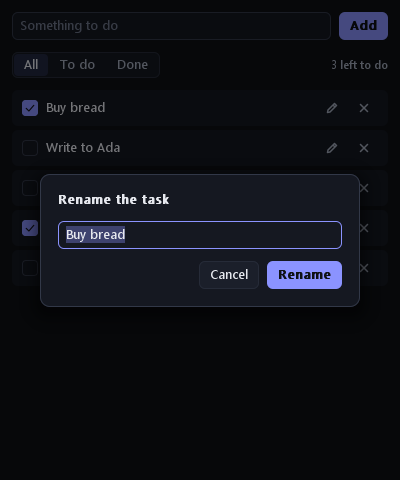

# 4. A real small app

A to-do list: add, tick, rename and remove tasks, filter them, follow the system's dark or light
theme, and save the list and the window's place to a file. It is `examples/todo.rs`:

```sh
cargo run -p taut --example todo
```

## A first list

Tasks with tick boxes:

```rust,no_run
use taut::{Ui, Window};

struct Task {
    text: String,
    done: bool,
}

fn list(tasks: &mut [Task], ui: &mut Ui) {
    let t = ui.theme;
    ui.column().grow().scroll().pad(12.0).gap(4.0).open();
    for task in tasks.iter_mut() {
        ui.row().pad((10.0, 4.0)).fill(t.panel).radius(6.0).open();
        ui.checkbox(&mut task.done, &task.text);
        ui.close();
    }
    ui.close();
}

fn main() {
    let task = |text: &str, done| Task { text: text.into(), done };
    let mut tasks = vec![task("Buy bread", true), task("Write to Ada", false), task("Fix the gate", false)];
    taut::run(Window { title: "To do", width: 400.0, height: 200.0, ..Default::default() }, move |ui| list(&mut tasks, ui));
}
```



A growing, scrolling column of rows; each tick box is bound to `task.done`, so a click ticks the
task itself.

## The whole program

One function per section of the window; each returns whether it changed the list, so the list
is saved only then.

```text
describe
    adding      the box a new task is typed into, and the Add button
    showing     which tasks show, and how many are left
    list        the tasks
    renaming    the dialog a task is renamed in, while one is
```

```rust,no_run
//! A list of things to do: the app the fourth chapter of the book builds, step by step
//! (`docs/04-a-real-small-app.md`). Tasks are added, ticked, renamed and taken away; the list
//! shows all of them, those left, or those done; and it is kept in a file between runs,
//! together with where the window was.
//!   cargo run -p taut --example todo
use std::path::PathBuf;
use taut::{Align, Icon, Key, Mods, Placed, Theme, Ui, Window};

const PEN: Icon = Icon::line("M3.5 12.5 4 10 10.5 3.5 12.5 5.5 6 12zM9 5l2 2");
const CROSS: Icon = Icon::line("M4.5 4.5 11.5 11.5M11.5 4.5 4.5 11.5");
/// Which tasks the list shows.
const SHOWN: [&str; 3] = ["All", "To do", "Done"];

/// One thing to do.
struct Task {
    /// What it is known by, whatever its place in the list.
    id: u64,
    text: String,
    done: bool,
}

/// Everything the app keeps.
struct App {
    tasks: Vec<Task>,
    /// What is typed into the box for a new task, so far.
    draft: String,
    /// Which tasks show: the number of one of `SHOWN`.
    shown: usize,
    /// The task being renamed, and its new name so far.
    renaming: Option<(u64, String)>,
    /// The number the next new task is known by.
    next: u64,
    /// Where the window is, as it last said.
    placed: Option<Placed>,
    /// The file the list is kept in.
    file: PathBuf,
}

fn describe(app: &mut App, ui: &mut Ui) {
    ui.theme = if ui.system_dark() { Theme::dark() } else { Theme::light() };
    app.placed = ui.placed().or(app.placed);
    let mut changed = adding(app, ui);
    showing(app, ui);
    changed |= list(app, ui);
    changed |= renaming(app, ui);
    if changed && app.save().is_err() {
        ui.notice("The list could not be saved");
    }
}

/// The box a new task is typed into, and the button that adds it. Says whether one was added.
fn adding(app: &mut App, ui: &mut Ui) -> bool {
    ui.row().pad(12.0).gap(8.0).open();
    let typed = ui.text_box(&mut app.draft, "Something to do");
    let add = ui.primary_button("Add").clicked || typed.focused && ui.key(Key::Enter, Mods::NONE);
    ui.close();
    // When the keyboard is on nothing (as the app starts), it goes to this box.
    if ui.focus() == 0 && app.renaming.is_none() {
        ui.set_focus(typed.id);
    }
    if !add || app.draft.trim().is_empty() {
        return false;
    }
    app.tasks.push(Task { id: app.next, text: app.draft.trim().into(), done: false });
    app.next += 1;
    app.draft.clear();
    true
}

/// Which tasks show, and how many are left to do.
fn showing(app: &mut App, ui: &mut Ui) {
    let left = app.tasks.iter().filter(|task| !task.done).count();
    ui.row().pad((12.0, 0.0)).gap(8.0).open();
    ui.segmented(&mut app.shown, &SHOWN);
    ui.spacer();
    ui.note(&format!("{left} left to do"));
    ui.close();
}

/// The tasks that show, each with a tick box and buttons to rename it and to take it away.
/// Says whether one was ticked or taken away.
fn list(app: &mut App, ui: &mut Ui) -> bool {
    let t = ui.theme;
    let (mut changed, mut gone, mut none) = (false, None, true);
    ui.column().grow().scroll().pad(12.0).gap(4.0).open();
    for task in app.tasks.iter_mut().filter(|task| [true, !task.done, task.done][app.shown]) {
        none = false;
        ui.row().key(task.id).pad((10.0, 4.0)).gap(4.0).fill(t.panel).radius(6.0).open();
        changed |= ui.checkbox(&mut task.done, &task.text).changed;
        ui.spacer();
        if ui.icon_button(PEN, "Rename").clicked {
            app.renaming = Some((task.id, task.text.clone()));
        }
        if ui.icon_button(CROSS, "Take away").clicked {
            gone = Some(task.id);
        }
        ui.close();
    }
    if none {
        ui.note(["Nothing to do yet.", "Nothing left to do.", "Nothing done yet."][app.shown]);
    }
    ui.close();
    app.tasks.retain(|task| Some(task.id) != gone);
    changed || gone.is_some()
}

/// The dialog a task is renamed in, while one is. Says whether a task got a new name.
fn renaming(app: &mut App, ui: &mut Ui) -> bool {
    let Some((id, name)) = &mut app.renaming else { return false };
    let t = ui.theme;
    let beside = ui.dialog();
    ui.text("Rename the task", t.font.bold(), t.text);
    let field = ui.text_box(name, "What is to be done");
    // (As the dialog opens, the keyboard goes into its box, with the old name selected.)
    if ui.focus() == 0 {
        ui.set_focus(field.id);
        ui.select_all();
    }
    ui.row().gap(8.0).align(Align::End, Align::Center).open();
    let cancel = ui.button("Cancel").clicked || ui.key(Key::Escape, Mods::NONE) || beside.clicked;
    let keep = ui.primary_button("Rename").clicked || ui.key(Key::Enter, Mods::NONE);
    ui.close();
    ui.close();
    let renamed = keep && !name.trim().is_empty();
    if let Some(task) = app.tasks.iter_mut().find(|task| task.id == *id).filter(|_| renamed) {
        task.text = name.trim().into();
    }
    if keep || cancel {
        app.renaming = None;
    }
    renamed
}

impl App {
    /// The list as it was left in `file`, or an empty one the first time.
    fn load(file: PathBuf) -> App {
        let text = std::fs::read_to_string(&file).unwrap_or_default();
        let mut lines = text.lines();
        let placed = lines.next().and_then(|line| line.parse().ok());
        let tasks: Vec<Task> = lines.enumerate().map(|(at, line)| Task { id: at as u64, done: line.starts_with("x "), text: line.get(2..).unwrap_or("").into() }).collect();
        App { next: tasks.len() as u64, tasks, draft: String::new(), shown: 0, renaming: None, placed, file }
    }

    /// Writes the list into its file: where the window is on the first line, then a line for
    /// each task, with `x` before one that is done and `-` before one that is not.
    fn save(&self) -> std::io::Result<()> {
        let mut text = self.placed.map_or(String::new(), |placed| placed.to_string());
        for task in &self.tasks {
            text += &format!("\n{} {}", if task.done { "x" } else { "-" }, task.text);
        }
        std::fs::write(&self.file, text)
    }
}

/// When the window closes, the app goes with it, and the list is written once more: now with
/// where the window was left. (Nobody is left to tell if that fails.)
impl Drop for App {
    fn drop(&mut self) {
        let _ = self.save();
    }
}

/// Where the list is kept: in the folder the system keeps the settings of programs in.
fn file() -> PathBuf {
    let folder = std::env::var_os("APPDATA").or_else(|| std::env::var_os("XDG_CONFIG_HOME")).map(PathBuf::from);
    let home = || std::env::var_os("HOME").map(|home| PathBuf::from(home).join(".config"));
    folder.or_else(home).unwrap_or_default().join("taut-todo.txt")
}

fn main() {
    let mut app = App::load(file());
    let window = Window { title: "To do", width: 400.0, height: 480.0, min_width: 280.0, min_height: 220.0, ..Default::default() };
    taut::run(window.placed(app.placed), move |ui| describe(&mut app, ui));
}
```







## How it works

**`adding`**

- Adds on the button, or on Enter while the box has focus: `ui.key(Key::Enter, Mods::NONE)` is
  true once and consumes the key (a one-line box has no use for Enter).
- `ui.focus()` is the focused id, 0 for none; `ui.set_focus(id)` moves focus. Here it goes to
  the box whenever focus is on nothing, as at start-up.
- The box clears at once: a click or consumed key reruns `describe` before drawing (chapter 3).

**`list`**

- `.key(task.id)` on each row: tasks come and go, so position is no identity. Keyed by id, focus
  and state stay with their task (chapter 3).
- `ui.icon_button(icon, hint)` draws a 16×16 SVG-path icon; the hint shows on hover and names the
  button for screen readers.
- The removed task's id is noted in the loop and removed after it; the click's rerun shows the
  row gone at once.
- `ui.spacer()` pushes the buttons right; the tick box's words wrap when narrow.

**`showing`**

`ui.segmented` is a row of exclusive choices bound to an index (`app.shown`). The count is
computed each run, so it is always current.

**`renaming`**

- The dialog is open while `app.renaming` is `Some`: no dialog object to show or hide.
- `ui.dialog()` is a centred modal box; its `Response` reports clicks beside it, a common way
  to cancel, as is Escape.
- The new name is typed into the app's own `String`, so Cancel changes nothing; an empty name
  keeps the old one.
- The opening button is now covered, so focus is on nothing for a moment: that is when it moves
  into the box. `ui.select_all()` selects the old name.

**Theme and saving**

- `ui.system_dark()` picks the theme; when the user changes the setting, `describe` reruns
  (chapter 7).
- The file is plain text: the window's place (as `Placed` writes it), then a line per task:

```text
300 200 400 480 0
x Buy bread
- Write to Ada
- Fix the gate
```

- Saved whenever a part changed the list, and on close: `taut::run` drops the app with the
  window, and `Drop` saves the window's final place.
- `ui.placed()` reports position and size; `Window { .. }.placed(..)` reopens there (or where the
  system chooses, if that place is off every screen).
- The file is in the settings folder (`%APPDATA%`; `$XDG_CONFIG_HOME` or `~/.config`). It is a
  field of `App`, so a test can pass its own (chapter 8). `taut::kept::folder` and
  `taut::kept::write` do the same, writing atomically (guide: "Kept between runs").
- A failed save shows a `ui.notice(..)`.
- `Table`, `Panel`, `Dock` and `Second` save the same way, with `to_string()` and `parse()`; a
  line that doesn't parse is rejected whole.
- For release on Windows, add `#![windows_subsystem = "windows"]` at the top (chapter 1).

## Summary

- Keep the app's state in one struct; describe the window with one function per section.
- Key rows by the item's own id.
- A dialog is open while the state says so; `ui.set_focus` and `ui.select_all` place the cursor.
- Save plain text; `ui.placed()` and `Window::placed` restore the window.

Next: [larger parts](05-larger-parts.md).
