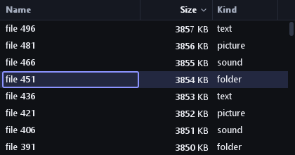
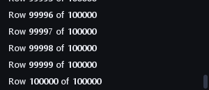
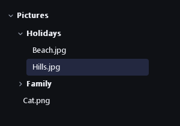
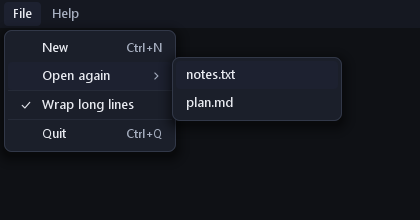
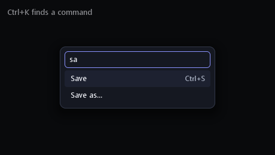
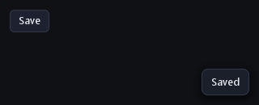
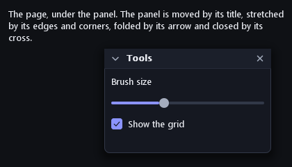
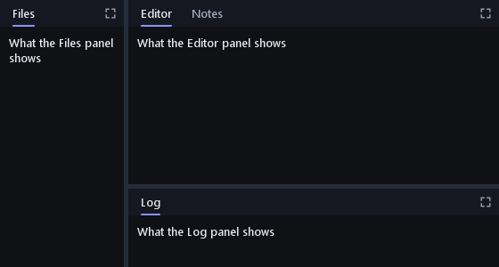
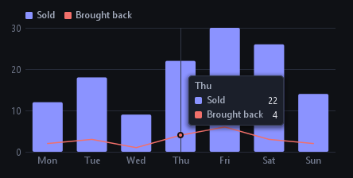

# 5. Larger parts

Each is one call, takes a value the app keeps, returns what the user did, and opens and closes
like any box. What a part keeps for the user (sort order, panel position) is the app's value,
one line of text when saved.

## Tables

```rust
use std::cmp::Ordering;
use taut::{Align, Column, Picks, Table, Ui};

const COLUMNS: [Column; 3] = [Column::new("Name"), Column::new("Size").px(90.0).align(Align::End), Column::new("Kind").px(80.0)];

struct File {
    name: String,
    size: u64,
    kind: &'static str,
}

struct App {
    files: Vec<File>,
    table: Table,
    picks: Picks,
}

fn describe(app: &mut App, ui: &mut Ui) {
    if ui.table(&mut app.table, &COLUMNS).changed {
        let by = app.table.sort.clone();
        app.files.sort_by(|a, b| order(a, b, &by));
        app.picks.clear();
    }
    for row in ui.rows(app.files.len(), 24.0) {
        if ui.pick_row(row, app.picks.has(row)).clicked {
            app.picks.click(row, ui.mods());
        }
        let file = &app.files[row];
        ui.label(&file.name);
        ui.label(&format!("{} KB", file.size));
        ui.label(file.kind);
        ui.close();
    }
    ui.close();
    ui.close();
}

/// How two files compare in the order the headings ask for: by the column that counts
/// most, and where that is the same, by the next.
fn order(a: &File, b: &File, by: &[(usize, bool)]) -> Ordering {
    for &(column, large_first) in by {
        let (a, b) = if large_first { (b, a) } else { (a, b) };
        let order = match column {
            0 => a.name.cmp(&b.name),
            1 => a.size.cmp(&b.size),
            _ => a.kind.cmp(b.kind),
        };
        if order.is_ne() {
            return order;
        }
    }
    Ordering::Equal
}
```



- **`Column`:** heading, width (`.px(90.0)` or a share), alignment (`.align(Align::End)`),
  sortable unless `.unsorted()`.
- **`Table`:** the user's sort, widths, order and hidden columns. A heading click sets
  `changed`; sort the rows by `table.sort` (column, descending), most significant first.
  Shift-click adds a column.
- **Rows:** `ui.rows(count, height)` yields only visible row numbers; a million rows cost a
  screenful. Each box in a row is the next cell.
- **Selection:** `ui.pick_row(key, picked)`; `Picks` stores it; `picks.click(row, ui.mods())`
  handles Ctrl and Shift. Plain rows: `ui.table_row().open()`.
- **The user** resizes columns by their edges, drags headings to reorder, right-clicks to hide.
- **Too wide:** scrolls sideways; `Table { kept: 1, ..Default::default() }` pins the first
  column; `ui.table_row().kept()` pins a row at the top (before the rows) or bottom (after).
- **Close** the rows, then the table. Screen readers get the table's structure.

## Long lists

`ui.list(count, height)` is a scroll box of `count` rows, yielding the visible ones; describe a
box each, then close it:

```rust
use taut::Ui;

fn describe(ui: &mut Ui) {
    for row in ui.list(100_000, 24.0) {
        ui.row().pad((12.0, 0.0)).open();
        ui.label(&format!("Row {} of 100000", row + 1));
        ui.close();
    }
    ui.close();
}
```



- Cost is the visible rows. Every row must be exactly `height`.
- Inside an existing scroll box, use `ui.rows(count, height)`.
- Rows are numbered from the first overall, so their state survives scrolling; arrows move
  between focusable rows and scroll along.

## Trees

`ui.tree(&mut open, title)` is a folding heading with indented content: while `open`, describe
the children, then close it. `clicked` reports a press; `changed` any toggle (arrows too).
`ui.picked_tree(&mut open, title, picked)` adds selection.

```rust
use taut::{Length, Ui};

struct Folders {
    open: [bool; 3],
    picked: usize,
}

fn describe(app: &mut Folders, ui: &mut Ui) {
    ui.column().w(Length::Px(260.0)).pad(12.0).gap(2.0).open();
    ui.tree(&mut app.open[0], "Pictures");
    if app.open[0] {
        ui.tree(&mut app.open[1], "Holidays");
        if app.open[1] {
            leaf(app, ui, 0, "Beach.jpg");
            leaf(app, ui, 1, "Hills.jpg");
            ui.close();
        }
        ui.tree(&mut app.open[2], "Family");
        if app.open[2] {
            leaf(app, ui, 2, "Ada.png");
            ui.close();
        }
        leaf(app, ui, 3, "Cat.png");
        ui.close();
    }
    ui.close();
}

fn leaf(app: &mut Folders, ui: &mut Ui, number: usize, name: &str) {
    if ui.selectable(app.picked == number, name).clicked {
        app.picked = number;
    }
}
```



`open` is the app's, so trees are described by walking app data. For huge trees, `ui.branches`
fetches children on open and describes only visible rows (guide: "The larger parts").

## Menus

```rust
use taut::Ui;

struct Editor {
    wrap: bool,
    said: String,
}

fn describe(app: &mut Editor, ui: &mut Ui) {
    ui.menu_bar();
    if ui.menu_button("File") {
        if ui.menu_item("New\tCtrl+N").clicked {
            app.said = "A new file".into();
        }
        if ui.submenu("Open again") {
            for name in ["notes.txt", "plan.md"] {
                if ui.menu_item(name).clicked {
                    app.said = format!("Opened {name}");
                }
            }
            ui.close();
        }
        ui.separator();
        ui.menu_check(&mut app.wrap, "Wrap long lines");
        ui.separator();
        if ui.menu_item("Quit\tCtrl+Q").clicked {
            ui.quit();
        }
        ui.close();
    }
    if ui.menu_button("Help") {
        ui.menu_item("About");
        ui.close();
    }
    ui.close();
    // The keys the menu shows are the app's to ask for.
    if ui.keys("Ctrl+N") {
        app.said = "A new file".into();
    }
    if ui.keys("Ctrl+Q") {
        ui.quit();
    }
    ui.column().pad(12.0).open();
    ui.label(&app.said);
    ui.close();
}
```



- `ui.menu_bar()`, then `ui.menu_button(name)` per menu (open while true). With one open,
  hovering opens the others; Left and Right switch.
- `ui.menu_item(text)` (closes the menu), `ui.menu_check(&mut on, text)`, `ui.submenu(text)`,
  `ui.separator()`.
- Text after a tab is a shortcut, shown and told to readers; handle it with `ui.keys("Ctrl+N")`.
- Arrows move, Enter picks, Escape closes.

From any button, or at the pointer on right-click:

```rust
use taut::Ui;

fn describe(ui: &mut Ui) {
    // From a button: opened by the app, against the button.
    let more = ui.button("More");
    if more.clicked {
        ui.open_popup(more.id, more.rect);
    }
    if ui.menu(more.id) {
        ui.menu_item("Copy the link");
        ui.menu_item("Share");
        ui.close();
    }
    // At the pointer, when the row is clicked with the right button.
    let row = ui.selectable(false, "report.txt");
    if ui.context_menu(&row) {
        ui.menu_item("Rename");
        ui.menu_item("Delete");
        ui.close();
    }
    // And a few words when the pointer rests on the row.
    ui.tooltip(&row, "Written on Monday");
}
```

`ui.select(&mut choice, &options)` is a drop-down; `ui.combo` filters long lists by typing.

## Dialogs

`ui.dialog()` is a centred modal box while described (chapter 4); `ui.dialog_up_to(width)` for
wider than 520 units. The file dialog returns its answer once:

```rust
use std::path::PathBuf;
use taut::{Files, Ui};

struct App {
    dialog: Files,
    picture: Option<PathBuf>,
}

fn describe(app: &mut App, ui: &mut Ui) {
    if ui.button("Open a picture\u{2026}").clicked {
        app.dialog.only(&[".png", ".jpg"]);
        app.dialog.pick(".");
    }
    if let Some(file) = ui.file_dialog(&mut app.dialog) {
        app.picture = Some(file);
    }
}
```

- `dialog.save(folder, name)`, `dialog.pick_folder(folder)`.
- `Files::default()`: the library's dialog, the same everywhere; text in `dialog.words`.
- `Files::of_the_system()`: the system's where available (Windows; a Linux portal), same
  answers.

## Command palette and notices

`ui.palette(&mut open, &commands)` filters commands as the user types; the picked index comes
back and the box closes:

```rust
use taut::Ui;

const COMMANDS: [&str; 6] = ["New file\tCtrl+N", "Open a file\tCtrl+O", "Save\tCtrl+S", "Save as\u{2026}", "Search the files\tCtrl+Shift+F", "Settings"];

struct App {
    finding: bool,
    said: String,
}

fn describe(app: &mut App, ui: &mut Ui) {
    app.finding |= ui.keys("Ctrl+K");
    if let Some(command) = ui.palette(&mut app.finding, &COMMANDS) {
        app.said = format!("Picked: {}", COMMANDS[command].split('\t').next().unwrap_or(""));
    }
    ui.column().pad(12.0).open();
    ui.label(&app.said);
    ui.close();
}
```



`ui.notice(text)`: a bottom-right toast for four seconds, announced to screen readers. Call it
once, when the event happens:

```rust
use taut::Ui;

fn describe(ui: &mut Ui) {
    ui.row().pad(12.0).open();
    if ui.button("Save").clicked {
        ui.notice("Saved");
    }
    ui.close();
}
```



`ui.notice_for(text, duration)` sets the time; `ui.notices(across, down)` holds custom notices.

## Floating panels

```rust
use taut::{Panel, Ui};

struct App {
    tools: Panel,
    size: f32,
    grid: bool,
}

fn describe(app: &mut App, ui: &mut Ui) {
    ui.column().grow().pad(12.0).open();
    ui.paragraph("The page, under the panel. The panel is moved by its title, stretched by its edges and corners, folded by its arrow and closed by its cross.");
    ui.close();
    if ui.panel(&mut app.tools, "Tools") {
        ui.label("Brush size");
        ui.slider(&mut app.size, 1.0..=10.0);
        ui.checkbox(&mut app.grid, "Show the grid");
        ui.close();
    }
}
```



`Panel` holds position, size, open and folded. `Panel::new(x, y, width, height)` sets the first
placement; `panel.open = true` reopens. `ui.pin(across, down)` pins the next box to a window
edge or corner, over everything (task bars, floating buttons).

## Docking panels

```rust
use taut::{Dock, Ui};

/// How the panels lie the first time: the files at the left, a quarter of the width; the
/// editor and the notes behind tabs, over the log.
fn first() -> Dock {
    Dock::of(&["Files"]).beside(Dock::of(&["Editor", "Notes"]).above(Dock::of(&["Log"]), 0.7), 0.25)
}

fn describe(dock: &mut Dock, ui: &mut Ui) {
    ui.dock(dock);
    for name in ["Files", "Editor", "Notes", "Log"] {
        if ui.docked(dock, name) {
            ui.paragraph(&format!("What the {name} panel shows"));
            ui.close();
        }
    }
    ui.close();
}
```



- `Dock`: split, stacked and tabbed, nested freely. The user drags tabs to drop markers; dropped
  elsewhere, a panel floats; dividers drag.
- `ui.dock(&mut dock)`, then `ui.docked(&mut dock, name)` per panel (close while true), then
  close the dock. Unknown names join the first tab group.
- Save with `to_string()`, restore with `parse()`; `.only(&names)` drops panels no longer there.

## Second windows

A system window, described inline while its `Second` is open:

```rust
use taut::{Second, Ui};

struct App {
    settings: Second,
    loud: bool,
}

fn describe(app: &mut App, ui: &mut Ui) {
    if ui.button("Settings").clicked {
        app.settings.open = true;
    }
    ui.checkbox(&mut app.loud, "Loud, said in the first window");
    if ui.window(&mut app.settings, "Settings") {
        ui.column().pad(12.0).open();
        ui.checkbox(&mut app.loud, "Loud, said in the second");
        ui.close();
        ui.close();
    }
}
```

- Both windows share `app`; changes show in both at once.
- Closed by its button (`settings.open` becomes false), by no longer describing it, or by
  `ui.quit()` inside it.
- `Second` remembers size and position. `Second::new(w, h)` starts open; `Second::default()`
  closed.

## Tray and system notifications

```rust
use taut::Ui;

struct App {
    icon: Vec<u32>,
    quiet: bool,
}

fn describe(app: &mut App, ui: &mut Ui) {
    // The icon, with a hint, and the rows of its menu, which is the system's own.
    if ui.tray(&[(16, &app.icon)], "Notes").clicked {
        ui.come_forward();
    }
    ui.tray_check(&mut app.quiet, "&Quiet");
    if ui.tray_item("&Quit") {
        ui.quit();
    }
    // Closed, the window goes to the tray instead of away.
    if ui.close_asked() {
        ui.keep_open("");
        ui.hide_window();
    }
    if ui.button("Remind me").clicked && !app.quiet {
        ui.system_notification("Notes", "Three notes are due today", None);
    }
}
```

- Icon: one or more sizes of `0xAARRGGBB` pixels. A menu row is true once, the run after it was
  picked.
- `ui.hide_window()` hides window and task-bar button; `ui.come_forward()` restores.
- Global hotkeys and single instance: guide, "Beyond the window". Unused, none of it is compiled
  in.

## Charts

```rust
use taut::{Chart, Series, Ui};

fn describe(ui: &mut Ui) {
    let t = ui.theme;
    let sold = [12.0, 18.0, 9.0, 22.0, 30.0, 26.0, 14.0];
    let back = [2.0, 3.0, 1.0, 4.0, 6.0, 3.0, 2.0];
    let rows = [Series::bars("Sold", &sold), Series::line("Brought back", &back).color(t.red)];
    let days = ["Mon", "Tue", "Wed", "Thu", "Fri", "Sat", "Sun"];
    ui.column().pad(12.0).open();
    ui.chart(&Chart::of(&rows).names(&days), 420.0, 200.0);
    ui.close();
}
```



- `Series::bars`, `line`, `area`, `points`. `names` labels x; `.across(first, last)` sets the x
  range; `.up(least, most)` fixes y; `.at(&xs)` gives a series its own x; `f32::NAN` is a gap;
  `.smooth()` curves without overshoot.
- Hover shows values; with focus, Left and Right step through them for screen readers.
  `ui.chart_at(&response)` is the hovered index.
- `ui.plot_lines` and `ui.plot_bars`: sparklines without axes.

## Drag and drop

```rust
use taut::Ui;

struct App {
    things: Vec<String>,
}

fn describe(app: &mut App, ui: &mut Ui) {
    let t = ui.theme;
    ui.row().pad(12.0).gap(12.0).open();
    ui.column().gap(2.0).open();
    for (number, thing) in app.things.iter().enumerate() {
        let row = ui.selectable(false, thing);
        // Pressed and moved a little, the row is carried: what is described here follows the pointer.
        if ui.carried(&row, number as u64) {
            ui.label(thing);
            ui.close();
        }
    }
    ui.close();
    let edge = if ui.carrying().is_some() { t.accent } else { t.line };
    let bin = ui.column().size(140.0, 80.0).pad(8.0).fill(t.panel).border(edge, 1.0).radius(6.0).sense().open();
    ui.note("Let go here to throw it away");
    ui.close();
    ui.close();
    if let Some(number) = ui.dropped(&bin) {
        app.things.remove(number as usize);
    }
}
```

The carried value is a number meaningful to the app; `ui.carrying()` reports it during the
drag; `ui.dropped(&on)` reports a drop on a sensing box. Files from other programs:
`ui.files_over()`, `ui.files_dropped(&on)`.

## The rest

Every other part is one call (guide, "Every ready-made part"): tabs, segmented choices, radio
buttons, sliders, numbers, colour, date, suggestions, passwords, progress, splitters, tool bars;
also boards, node graphs, the code box, the inspector, Markdown, and frameless windows.

## Summary

- A large part is one call with a value the app keeps: `Table`, `Picks`, `Panel`, `Dock`,
  `Second`, `Files`.
- `ui.rows` and `ui.list` describe only visible rows.
- Menus, dialogs, panels, windows and the tray icon exist while the app's state says so.
- Menu shortcuts are handled with `ui.keys`, in the same notation.

Next: [text and pictures](06-text-and-pictures.md).
