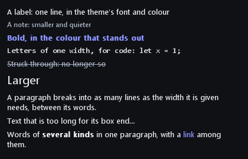
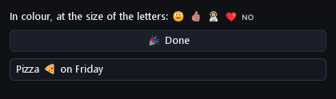
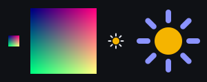
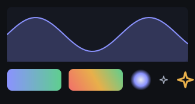
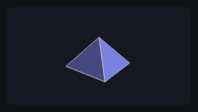

# 6. Text and pictures

Text, fonts, emoji, pictures, SVG, shapes, 3D scenes, PDF and printing.

## Text

```rust
use taut::{Font, Length, Ui};

fn describe(ui: &mut Ui) {
    let t = ui.theme;
    ui.column().pad(12.0).gap(6.0).open();
    ui.label("A label: one line, in the theme's font and colour");
    ui.note("A note: smaller and quieter");
    ui.text("Bold, in the colour that stands out", t.font.bold(), t.accent);
    ui.text("Letters of one width, for code: let x = 1;", t.font.mono(), t.text);
    ui.text("Struck through: no longer so", t.font.struck(), t.text_dim);
    ui.text("Larger", Font::new(20.0), t.text);
    ui.paragraph("A paragraph breaks into as many lines as the width it is given needs, between its words.");
    ui.el().w(Length::Px(220.0)).clip().text("Text that is too long for its box ends in dots", t.font, t.text).show();
    ui.wrapping_row().open();
    ui.words("Words of ", t.font, t.text);
    ui.words("several kinds", t.font.bold(), t.text);
    ui.words(" in one paragraph, with a ", t.font, t.text);
    ui.link("link");
    ui.words(" among them.", t.font, t.text);
    ui.close();
    ui.close();
}
```



- `ui.label`, `ui.note`: one line in the theme's font or small font. `ui.text(text, font, color)`:
  any font and colour.
- `Font::new(20.0)` with `.bold()`, `.mono()`, `.underlined()`, `.struck()`. The theme's
  `t.font` (13) and `t.small` (11.5) are used by every part.
- `ui.paragraph` wraps, as does `.wrap()` on a box; `.text_align(Align::Center)` centres lines;
  `.clip()` ends overflow in "…".
- Mixed styles: a `ui.wrapping_row()` of `ui.words(..)` and `ui.link(..)`, wrapping together.
- `ui.text_width(text, font)`; `ui.label_downward(text)` for vertical CJK text.

**System text:** GDI on Windows (Segoe UI; monospace: Cascadia Mono, Consolas or Courier New),
FreeType and Fontconfig on Linux, with the user's smoothing settings.

**App fonts:** TrueType, OpenType, WOFF (WOFF2 with `woff2`; CFF outlines with `cff`). Set once,
in the first run:

```rust
use taut::{FontFile, OwnFonts, Ui};

/// Has the whole interface written in the app's own font, from files beside the program.
fn own_fonts(ui: &mut Ui) -> Option<()> {
    let regular = FontFile::read(std::fs::read("fonts/Inter-Regular.ttf").ok()?)?;
    let bold = FontFile::read(std::fs::read("fonts/Inter-Bold.ttf").ok()?)?;
    ui.set_fonts(OwnFonts::new(regular).bold(bold));
    Some(())
}
```

- `ui.set_fonts` falls back to system text for missing letters;
  `ui.set_text(Box::new(OwnFonts::new(..)))` uses only the files. Embed with `include_bytes!`.
- Kerned by the file; small letters snap vertically to whole pixels (`.smooth()` turns it off).
- Icon fonts: `.shape(&font.outline('\u{e88a}', 16.0), color)`.

**Scripts:** enable what users may type or files may hold:

```toml
[dependencies]
taut = { version = "0.1", features = ["right-to-left", "brahmic", "emoji"] }
```

- `right-to-left`: Hebrew, Arabic, Persian, Urdu in reading order, Arabic joined (without it:
  left to right, as typed).
- `brahmic`: Indic and South-East Asian scripts shaped by syllable (without it: the system's
  text, whole on Windows, letter by letter on Linux).
- Others and their costs: [costs](costs-and-speed.md#what-it-costs).

## Emoji

```rust
use taut::Ui;

fn describe(note: &mut String, ui: &mut Ui) {
    ui.column().pad(12.0).gap(8.0).open();
    ui.label("In colour, at the size of the letters: 🙂 👍🏽 👩‍🚀 ❤️ 🇳🇴");
    ui.button("🎉 Done");
    ui.text_box(note, "Typed into a box, too");
    ui.close();
}
```



- Feature `emoji`: colour emoji in all text, at text size; sequences (families, skin tones,
  flags) are one glyph and one cursor step.
- From the system's emoji font. Windows' has no flags (two letters above). No emoji font: boxes.
- `ui.set_emoji(FontFile::open(path)?)` uses the app's font; `ui.emoji_in_full()` draws every
  colour format. Both work without the feature.

## Pictures

```rust
use taut::{Drawing, Picture, Ui};

/// A sun, as an SVG file says it: its rays take the colour they are shown in.
const SUN: &str = r##"<svg xmlns="http://www.w3.org/2000/svg" viewBox="0 0 24 24">
  <circle cx="12" cy="12" r="5" fill="#f5b400"/>
  <path d="M12 1.5v3M12 19.5v3M1.5 12h3M19.5 12h3M4.6 4.6l2.1 2.1M17.3 17.3l2.1 2.1M4.6 19.4l2.1-2.1M17.3 6.7l2.1-2.1"
    stroke="currentColor" stroke-width="2" stroke-linecap="round"/>
</svg>"##;

struct App {
    pixels: Option<Picture>,
    sun: Option<Drawing>,
}

fn describe(app: &mut App, ui: &mut Ui) {
    let t = ui.theme;
    // Handed over once, kept by the library from then on.
    if app.pixels.is_none() {
        // Sixteen by sixteen pixels: red grows to the right, green downwards.
        let pixels = (0..256u32).map(|i| 0xff00_0080 | (i % 16 * 17) << 16 | (i / 16 * 17) << 8).collect();
        app.pixels = Some(ui.add_picture(16, pixels));
        app.sun = ui.add_drawing(SUN);
    }
    ui.row().pad(12.0).gap(16.0).open();
    if let Some(pixels) = app.pixels {
        ui.picture(pixels);
        ui.el().picture(pixels).size(96.0, 96.0).show();
    }
    if let Some(sun) = app.sun {
        ui.el().drawing(sun, t.text).size(24.0, 24.0).show();
        ui.el().drawing(sun, t.accent).size(96.0, 96.0).show();
    }
    ui.close();
}
```



- **Pixels:** `ui.add_picture(width, pixels)` (rows top down, `0xAARRGGBB`) returns a `Picture`.
  Show with `ui.picture(picture)` or `ui.el().picture(picture).size(w, h)`: smooth upscaling,
  averaged downscaling. `ui.set_picture` replaces pixels; `ui.drop_picture` frees.
- **Files:** `ui.add_picture_file(&bytes)` reads PNG, JPEG, GIF, WebP, BMP or ICO, else `None`:

```rust
use taut::{Picture, Ui};

fn photo(ui: &mut Ui) -> Option<Picture> {
    let bytes = std::fs::read("holiday.jpg").ok()?;
    ui.add_picture_file(&bytes)
}
```

- Decoders are the library's own. With `include_bytes!`, only the needed decoder is compiled in.
  `png::decode`, `png::encode`, `jpeg::decode`, `gif::decode`… work on plain pixels.
- **SVG:** `ui.add_drawing(svg_text)` returns a `Drawing`; `.drawing(drawing, color)` shows it,
  sharp at any size; `color` fills `currentColor`. Text, filters and embedded pictures after
  `svg::read_text()`, `svg::read_filters()`, `svg::read_pictures()`. No animation.
- **Animations:** `ui.add_film(bytes)` (GIF, PNG, WebP), `.film(film)`; only its box redraws.

## Shapes

```rust
use taut::{Flow, Icon, Path, Ui};

const STAR: Icon = Icon::line("M8 1.8 9.4 6.6 14.2 8 9.4 9.4 8 14.2 6.6 9.4 1.8 8 6.6 6.6z");

fn describe(ui: &mut Ui) {
    let t = ui.theme;
    // A wave, as a line and as the area under it.
    let (wide, high) = (300.0, 90.0);
    let (mut line, mut area) = (Path::new(), Path::new());
    area.move_to(0.0, high);
    for step in 0..=60 {
        let (x, y) = (step as f32 * wide / 60.0, high / 2.0 - (step as f32 / 6.0).sin() * 28.0);
        area.line_to(x, y);
        match step {
            0 => line.move_to(x, y),
            _ => line.line_to(x, y),
        };
    }
    area.line_to(wide, high).close();
    ui.column().pad(12.0).gap(12.0).open();
    ui.el().flow(Flow::Layers).size(wide, high).fill(t.panel).radius(6.0).clip().open();
    ui.el().size(wide, high).shape(&area, t.accent.alpha(0.25)).show();
    ui.el().size(wide, high).outline(&line, 2.0, t.accent).show();
    ui.close();
    // Fills that go from colour to colour, and icons drawn from SVG path data.
    ui.row().gap(12.0).open();
    ui.el().size(90.0, 36.0).radius(8.0).gradient_across(t.accent, t.green).show();
    ui.el().size(90.0, 36.0).radius(8.0).gradient_along(60.0, &[(0.0, t.red), (0.5, t.amber), (1.0, t.green)]).show();
    ui.el().size(36.0, 36.0).radius(18.0).gradient_around(&[(0.0, t.text), (0.6, t.accent), (1.0, t.accent.alpha(0.0))]).show();
    ui.icon(STAR);
    ui.el().icon(STAR, 32.0, t.amber).show();
    ui.close();
    ui.close();
}
```



- `Path`: `move_to`, `line_to`, `quad_to`, `cubic_to`, `close`, `circle`, `arc`, `rounded_rect`,
  `smooth_through(&points)`, `rounded_through(&points, radius)`, `Path::svg(data)`. Units from
  the box's top-left, clipped to the box.
- `.shape(&path, color)` fills; `.outline(&path, width, color)` strokes.
- Gradients: `.gradient_across`, `.gradient`, `.gradient_along(degrees, &stops)`,
  `.gradient_around(&stops)`.
- `Icon::line(..)` and `Icon::solid(..)`: SVG path data in 16×16. `ui.icon`,
  `.icon(icon, size, color)`, `ui.icon_button`.
- Anti-aliased; curves within 1/64 px at any size.

## 3D scenes

Meshes are handed over once; each run sets the view and how each mesh is drawn:

```rust
use taut::{Mesh, Ui, View};

/// A body with four sides and a square floor: five points, and four triangles, each
/// said by the numbers of its three corners.
fn pyramid(ui: &mut Ui) -> Mesh {
    let points = vec![[-5.0, 0.0, -5.0], [5.0, 0.0, -5.0], [5.0, 0.0, 5.0], [-5.0, 0.0, 5.0], [0.0, 6.0, 0.0]];
    ui.add_mesh(points, vec![[0, 1, 4], [1, 2, 4], [2, 3, 4], [3, 0, 4]])
}

fn describe(body: &mut Option<Mesh>, ui: &mut Ui) {
    let t = ui.theme;
    let pyramid = *body.get_or_insert_with(|| pyramid(ui));
    let view = View::look([13.0, 9.0, 17.0], [0.0, 2.0, 0.0]);
    ui.row().pad(12.0).open();
    ui.el().size(300.0, 160.0).fill(t.panel).radius(6.0).scene(&view, &[pyramid.filled(t.accent).outlined(t.text)]).show();
    ui.close();
}
```



CPU-drawn on all cores, only on change: a million triangles at 1920×1080 in about 14 ms. More in
the guide's "Scenes".

## PDF and printing

A `Paper` holds pages of any size, in window units (1/96 inch). Save as PDF or print:

```rust
use taut::{Color, Font, Paper, Path, Pen, Printing, Ui};

fn report() -> Paper {
    let mut paper = Paper::new();
    paper.page(Paper::A4);
    paper.text("Sales", 72.0, 72.0, Font::new(28.0).bold(), Color::BLACK);
    let mut line = Path::new();
    line.smooth_through(&[(72.0, 300.0), (200.0, 220.0), (320.0, 260.0), (440.0, 180.0)]);
    paper.outline(&line, Pen::new(3.0), Color::rgb(0x2b6cb0));
    paper
}

fn describe(printing: &mut Option<Printing>, ui: &mut Ui) {
    if ui.button("Save as PDF").clicked {
        // Written on a thread of its own: the window goes on answering meanwhile.
        let paper = report();
        std::thread::spawn(move || std::fs::write("report.pdf", paper.pdf()));
    }
    if ui.button("Print").clicked {
        *printing = Some(taut::print(report(), "Report"));
    }
}

// A file a reader opens: its text is real text, which it finds and copies.
assert!(report().pdf().starts_with(b"%PDF-"));
```

- A `Paper` can be built and written on another thread.
- Text is shaped as in the window, fonts subset.
- `paper.markdown(..)` lays out a document; `paper.interface(..)` places a window's content as a
  picture.
- The print dialog is the system's; `Printing::done` reports the outcome a run or more later.

## Summary

- Text is the system's unless the app brings fonts; extra scripts and colour emoji are features.
- Pictures, drawings, films and meshes are handed over once and shown by handle; drop them when
  done.
- Any shape is a `Path` in a box; a `Paper` takes the same shapes, text and pictures.

Next: [everyone can use it](07-everyone-can-use-it.md).
