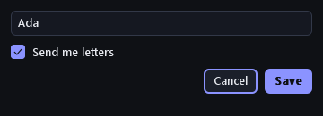
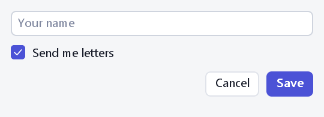

# 7. Everyone can use it

What the library does by itself, what the app must do, and what to check.

## The keyboard

With no app code: Tab and Shift+Tab in description order; Enter and Space press; arrows move
sliders, walk menus, and otherwise move focus spatially; Page Up/Down, Home and End scroll;
Escape closes menus. Menus and dialogs keep focus inside.

```rust
use taut::{Align, Ui};

struct Form {
    name: String,
    letters: bool,
}

fn describe(form: &mut Form, ui: &mut Ui) {
    ui.column().pad(12.0).gap(10.0).open();
    ui.text_box(&mut form.name, "Your name");
    ui.checkbox(&mut form.letters, "Send me letters");
    ui.row().gap(8.0).align(Align::End, Align::Center).open();
    ui.button("Cancel");
    ui.primary_button("Save");
    ui.close();
    ui.close();
}
```



Made with keys only: Tab, "Ada", Tab, Space, Tab. The focus ring shows only after keyboard
navigation, not after a click.

The app's part:

- **Describe in reading order:** that is the Tab order.
- **Set focus** when a window or dialog opens: `ui.set_focus(id)` (chapter 4); `ui.focus()`
  reads it.
- **Give commands shortcuts**, show them in menus (`"Save\tCtrl+S"`), handle them with
  `ui.keys("Ctrl+S")`.
- **Close dialogs on Escape** (chapter 4).
- **Custom parts** use `.focusable()` and `ui.press(id)` (Enter and Space click; chapter 3).

## Screen readers

UI Automation on Windows (Narrator, NVDA, JAWS) and AT-SPI on Linux (Orca) get each part's role,
name, state, position and shortcut, and can operate it. Nothing is built until a reader asks.
The app must provide:

1. **Names for wordless parts:** `ui.icon_button(icon, "Add a song")` (the hint is the name);
   `ui.tell` for custom boxes.
2. **Roles for custom parts:** `ui.tell(&response, Role::CheckBox, Some(on), "")`; more with
   `ui.tell_text`, `ui.tell_value`, `ui.tell_shortcut`, `ui.tell_position`, `ui.tell_step`. Call right
   after the box.
3. **Announcements for unseen changes:** `ui.announce("Saved")`; `ui.notice(..)` announces too.

Test it without a reader: `ui.set_screen_reader(true)` records what a reader would get; `ui.visible_access_nodes()` returns
it.

```rust
use taut::geom::Size;
use taut::text::BuiltInFont;
use taut::{Icon, LocalClipboard, Role, Ui};

const PLUS: Icon = Icon::line("M8 3.5v9M3.5 8h9");

fn describe(loud: &mut bool, ui: &mut Ui) {
    let t = ui.theme;
    ui.row().pad(12.0).gap(8.0).open();
    ui.icon_button(PLUS, "Add a song");
    ui.switch(loud, "Loud");
    // A green dot means nothing to someone who does not see it: it is told in words.
    let dot = ui.el().size(10.0, 10.0).radius(5.0).fill(t.green).sense().show();
    ui.tell(&dot, Role::Text, None, "Connected");
    ui.close();
}

let mut ui = Ui::new(Box::new(BuiltInFont), Box::new(LocalClipboard::default()));
ui.resize(Size { w: 400.0, h: 100.0 }, 1.0);
ui.set_screen_reader(true);
let mut loud = true;
// (What a run says is put together after it: so a second run, which hears the first.)
ui.run(&mut |ui| describe(&mut loud, ui));
ui.run(&mut |ui| describe(&mut loud, ui));
let nodes: Vec<(Role, &str, Option<bool>)> = ui.visible_access_nodes().iter().map(|node| (node.role, node.name.as_str(), node.on)).collect();
assert_eq!(nodes, [(Role::Button, "Add a song", None), (Role::Switch, "Loud", Some(true)), (Role::Text, "Connected", None)]);
```

- Each `AccessNode` also has `rect`, focus, enabled state, and the rest a reader gets. Chapter 8 finds
  parts by name this way.
- `ui.visible_access_nodes()` is what is visible; `ui.access_nodes()` includes what is scrolled out of view (`shown`
  says which). Readers can reach the whole page and scroll to what they read.
- A part inside something told as one (a button in a `Role::Row`) is exposed separately with
  `ui.tell_separately(&part)`.
- A long table describes only rows in view; `ui.tell_selection(&selection)` inside it tells
  readers every selected row. A reader asking for another row scrolls it into view.

## Dark, light and high contrast

`ui.system_theme()` follows the user's system: dark or light, accent colour, high contrast,
larger text.

```rust
use taut::Ui;

fn describe(ui: &mut Ui) {
    ui.theme = ui.system_theme();
    ui.label("As the person's system looks");
}
```

- Changes apply at once: the window reruns `describe`.
- The title bar is dark while the theme's background is.
- Each setting can be read alone: `ui.system_dark()`, `ui.system_accent()`,
  `ui.high_contrast()`, `ui.text_scale()`, `ui.reduced_motion()` (library animations already
  follow it).
- A custom look can still defer to high contrast and larger text: guide, "Looks".

## Sizes

The library scales everything to the screen: per monitor on Windows, the compositor's scale
under Wayland (fractional where offered), `Xft.dpi` under X. The form above, light, 150%:



`ui.system_theme()` also follows Windows' text-size setting; any theme can scale text:

```rust
use taut::{Theme, Ui};

fn describe(larger: bool, ui: &mut Ui) {
    let by = if larger { 1.25 } else { 1.0 };
    ui.theme = Theme::dark().text_scaled(by * ui.text_scale());
    ui.label("Every part is written in the theme's fonts, and grows with them");
}
```

## Contrast

WCAG asks 4.5:1 for small text and 3:1 for control edges. `Color::contrast` computes the ratio:

```rust
use taut::Theme;

for t in [Theme::dark(), Theme::light()] {
    for ink in [t.text, t.text_dim, t.accent] {
        assert!(ink.contrast(t.bg) >= 4.5 && ink.contrast(t.panel) >= 4.5);
    }
    assert!(t.on_accent.contrast(t.accent) >= 4.5);
}
```

The built-in dark and light themes:

- **Pass:** `text`, `text_dim`, `accent` on every background; text on primary buttons.
- **`text_faint`** (placeholders, disabled text): 3.7–4.2:1 dark, 3.2–3.5:1 light. Disabled text
  is exempt; put important hints in a label.
- **Light theme `red`, `green`, `amber`, `blue`** on the page: 3.8–4.4:1. Fine for marks, bars
  and large text, not small text.
- **`line_strong`** (empty text box and tick box edges): 1.6:1 dark, 1.4:1 light, below 3:1.

High-contrast themes pass everything, with text at 7:1; tests check each theme.

Don't rely on colour alone: say it in words or tell it, as the dot in the test above is told.

## Checklist

1. Tab reaches everything, in reading order, with a visible ring.
2. Icon-only buttons have hints; custom parts are told (`ui.set_screen_reader(true)`, `ui.visible_access_nodes()`).
3. Off-screen changes are announced.
4. Custom colours reach 4.5:1 for text and 3:1 for edges.
5. Works dark, light, high contrast, at 150% and 200%, and with larger text.
6. Try a real reader once: Narrator on Windows (Ctrl+Win+Enter), Orca on Linux (Super+Alt+S).

Next: [testing](08-testing.md).
