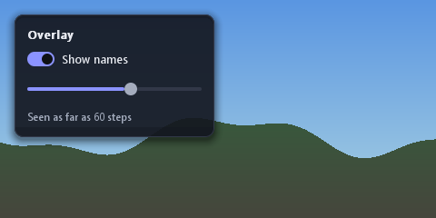
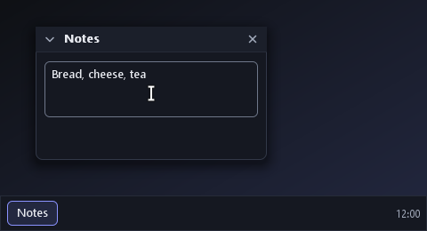

# 9. Inside another program

taut need not own the window. Everything works the same in a pixel buffer another program shows
(except screen readers, which need a taut window): a game's overlay, a DLL, a bare screen. Any
host does three things:

1. feed the `Ui` input (`ui.event`) and the time (`ui.set_time`);
2. run the description when something happened or when asked (`ui.run`, `ui.wake_in`);
3. draw what changed into a `Surface` and show its pixels.

## As a texture over a game

A program with its own renderer keeps a `Ui` and a `Surface`, forwards its window's input, and
draws the surface as a texture. Everything but the renderer-specific texture code:

```rust
use std::time::{Duration, Instant};
use taut::geom::{Size, pt};
use taut::text::BuiltInFont;
use taut::{Button, Color, Event, Length, LocalClipboard, Mods, Surface, Ui};

/// What the overlay's own parts are set to.
struct Settings {
    names: bool,
    range: f32,
}

fn describe(settings: &mut Settings, ui: &mut Ui) {
    let t = ui.theme;
    ui.column().w(Length::Px(220.0)).offset(16.0, 16.0).pad(14.0).gap(10.0).fill(t.panel.with_alpha(0.92)).border(t.line_strong, 1.0).radius(10.0).shadow(12.0).open();
    ui.text("Overlay", t.font.bold(), t.text);
    ui.switch(&mut settings.names, "Show names");
    ui.slider(&mut settings.range, 0.0..=100.0);
    ui.note(&format!("Seen as far as {:.0} steps", settings.range));
    ui.close();
}

/// The interface over a game: what it keeps, and its pixels.
struct Overlay {
    ui: Ui,
    pixels: Surface,
    settings: Settings,
    /// Something happened that the pixels do not show yet.
    waiting: bool,
    started: Instant,
}

impl Overlay {
    /// An overlay as large as the game's window, `width` by `height` pixels, on a screen
    /// that shows `scale` pixels to a unit.
    fn new(width: u32, height: u32, scale: f32) -> Overlay {
        let mut ui = Ui::new(Box::new(BuiltInFont), Box::new(LocalClipboard::default()));
        ui.theme.bg = Color::NONE;
        ui.resize(Size { w: width as f32 / scale, h: height as f32 / scale }, scale);
        let pixels = Surface::default(); // (drawn whole by the first `frame`)
        Overlay { ui, pixels, settings: Settings { names: true, range: 60.0 }, waiting: true, started: Instant::now() }
    }

    /// The game's window says the pointer moved here, in its pixels.
    fn pointer(&mut self, x: f32, y: f32) {
        let scale = self.ui.scale();
        self.waiting |= self.ui.event(Event::Move(pt(x / scale, y / scale)));
    }

    /// The game's window says the left button went down, or came up.
    fn button(&mut self, down: bool) {
        let event = if down { Event::Press(Button::Left, Mods::NONE) } else { Event::Release(Button::Left) };
        self.waiting |= self.ui.event(event);
    }

    /// Once a frame. The places of `self.pixels` that changed, in pixels (left, top, right,
    /// bottom), to copy into the texture; none, when nothing did, which is most frames.
    fn frame(&mut self) -> Vec<[usize; 4]> {
        self.ui.set_time(self.started.elapsed());
        let due = self.ui.wake_in() == Some(Duration::ZERO);
        if !std::mem::take(&mut self.waiting) && !due {
            return Vec::new();
        }
        let settings = &mut self.settings;
        self.ui.run(&mut |ui| describe(settings, ui));
        self.pixels.update(&mut self.ui)
    }

    /// Whether what the mouse does now is the overlay's, or the game's own.
    fn wants_pointer(&self) -> bool {
        self.ui.wants_pointer()
    }
}
```



- **Transparent:** `ui.theme.bg = Color::NONE`; the game shows through.
- **Pixels:** `0xAARRGGBB`, premultiplied (bytes B, G, R, A): Direct3D `B8G8R8A8_UNORM`, Vulkan
  `VK_FORMAT_B8G8R8A8_UNORM`, OpenGL `GL_BGRA`, wgpu `Bgra8Unorm`; blend "one, one minus source
  alpha".
- **Most frames cost nothing:** `frame` runs only after input or when due (`ui.wake_in()`);
  `surface.update` returns the changed regions in pixels; copy only those (`surface.upload`).
- **Input:** `ui.wants_pointer()` is true over the overlay's boxes, while a part is held, or with
  a menu or dialog open; otherwise the mouse is the game's. `ui.wants_keyboard()` likewise.
- **Text:** `BuiltInFont`, `platform::system_text()`, or app fonts (chapter 6).
- **Resize:** `ui.resize(..)`; the next `update` reports the full area; recreate the texture.

## Layers: Direct3D 9, 11 and 12, OpenGL, Vulkan

For these renderers the library keeps the texture. Make a layer once from the program's own
objects, then draw it over each frame with one call:

| Renderer | Made once | Each frame |
| --- | --- | --- |
| Direct3D 9, 9Ex | `layer_d3d9::Layer::new(device)` | `layer.draw(&mut ui)`, in the scene |
| Direct3D 11 | `layer_d3d11::Layer::new(device, context)` | `layer.draw(&mut ui)` |
| Direct3D 12 | `layer_d3d12::Layer::new(device, queue, format)` | `layer.draw(&mut ui, list, area)` |
| OpenGL 3.3+, OpenGL ES 3.0+ | `layer_opengl::Layer::new(&mut find)` | `layer.draw(&mut ui)` |
| Vulkan 1.0+ | `layer_vulkan::Layer::new(&handles)` | `layer.draw(&mut ui, commands, area)`, in the render pass |
| Metal (macOS, iOS) | `layer_metal::Layer::new(device, queue, format)` | `layer.draw(&mut ui, encoder, area)`, in the render pass |

```rust,ignore
// Direct3D 11: the program's ID3D11Device and ID3D11DeviceContext, as raw pointers.
// SAFETY: both are alive, and are what they are said to be.
let mut layer = unsafe { taut::layer_d3d11::Layer::new(device, context) }?;

// Each frame, once the program's picture is in the render target it has bound:
if waiting || ui.wake_in() == Some(Duration::ZERO) {
    ui.run(&mut |ui| describe(&mut app, ui));
}
layer.draw(&mut ui)?;
```

```rust,ignore
// OpenGL 3.3 or newer, core profile or not, its functions found the program's own way
// (wglGetProcAddress, eglGetProcAddress, glXGetProcAddress, or its window library's).
// SAFETY: the program's context is current, now and whenever the layer is called.
let mut layer = unsafe { taut::layer_opengl::Layer::new(&mut |name| find(name)) }?;
// ...and each frame:
unsafe { layer.draw(&mut ui) }?;
```

```rust,ignore
// Vulkan: the program's handles as raw values, and the render pass the layer is drawn in.
let handles = taut::layer_vulkan::Handles { instance, physical_device, device, queue, queue_family, render_pass, subpass: 0 };
// SAFETY: all of them live longer than the layer.
let mut layer = unsafe { taut::layer_vulkan::Layer::new(&handles) }?;
// ...each frame, recording the command buffer, in the render pass, after the program's drawing:
unsafe { layer.draw(&mut ui, commands, [0, 0, width, height]) }?;
// ...and at the end, with the device idle:
unsafe { layer.delete() };
```

- Uploads only changes (`UpdateSurface`, `UpdateSubresource`, `CopyTextureRegion`,
  `glTexSubImage2D`, `vkCmdCopyBufferToImage`, a Metal blit) and draws one premultiplied quad;
  idle frames upload nothing.
- Direct3D 12, Vulkan and Metal copy with commands of their own, run on the program's queue
  before its frame. A resize waits for the frames before (Metal's command buffers keep the old
  texture themselves).
- Draws at the top left of the viewport (Direct3D 9 and 11, OpenGL) or of `area` (Direct3D 12,
  Vulkan, Metal), clipped to it; size the `Ui` to match.
- Direct3D 9 and 11 and OpenGL restore all state they set. Direct3D 12, Vulkan and Metal have
  none to restore: after `draw`, set your own pipeline, root signature or descriptor sets,
  descriptor heaps, textures, viewport and scissor again.
- Lost devices: Direct3D 9 calls `layer.before_reset()` before `Reset` (9Ex needs none);
  Direct3D 12 and Vulkan return the error, and a new device takes a new layer.
- Errors are values: `Error`, with the operation and the system's message.
- Shaders are precompiled (Direct3D 11 and 12, Vulkan), compiled when the layer is made
  (OpenGL), or none (Direct3D 9 draws with its fixed function).
- Custom display (an in-world screen, VR): `layer.update(&mut ui)`, then draw `layer.texture()`.
- Targets are `B8G8R8A8_UNORM`, `GL_RGBA8` or alike; an sRGB target would lighten the interface
  (the OpenGL layer disables `GL_FRAMEBUFFER_SRGB` while drawing).
- Unused, a layer isn't compiled in.

`examples/d3d9.rs`, `d3d11.rs`, `d3d12.rs`, `opengl.rs` and `vulkan.rs` are complete programs.
`tests/renderers.rs` draws with each (Direct3D 11 and 12 on WARP, Direct3D 9Ex on the graphics
card on a desktop of its own, OpenGL on Mesa, Vulkan on lavapipe and the graphics card) and
compares with the surface pixel for pixel.

## Any other renderer

wgpu, bgfx, Skia, a game engine: keep a `Surface` and a same-sized texture.
`surface.upload(place)` gives each changed place as texture uploads take it: where, how large,
its bytes, and the bytes from row to row. With wgpu (a `Bgra8Unorm` texture,
`queue.write_texture` of changed places, and a premultiplied-alpha pipeline):

```rust,ignore
/// A texture as large as the interface's pixels, which the shader below reads.
fn texture(device: &wgpu::Device, surface: &Surface) -> wgpu::Texture {
    device.create_texture(&wgpu::TextureDescriptor {
        label: Some("taut"),
        size: wgpu::Extent3d { width: surface.width as u32, height: surface.height as u32, depth_or_array_layers: 1 },
        mip_level_count: 1,
        sample_count: 1,
        dimension: wgpu::TextureDimension::D2,
        format: wgpu::TextureFormat::Bgra8Unorm,
        usage: wgpu::TextureUsages::TEXTURE_BINDING | wgpu::TextureUsages::COPY_DST,
        view_formats: &[],
    })
}

/// After the interface has run: what changed is drawn, and only that is copied to the texture.
/// (A new texture, when the interface has a new size: the program makes its bind group again.)
fn update(device: &wgpu::Device, queue: &wgpu::Queue, layer: &mut wgpu::Texture, surface: &mut Surface, ui: &mut Ui) {
    for place in surface.update(ui) {
        if (layer.width(), layer.height()) != (surface.width as u32, surface.height as u32) {
            *layer = texture(device, surface);
        }
        let up = surface.upload(place);
        let at = wgpu::TexelCopyTextureInfo { texture: layer, mip_level: 0, origin: wgpu::Origin3d { x: up.x, y: up.y, z: 0 }, aspect: wgpu::TextureAspect::All };
        let size = wgpu::Extent3d { width: up.width, height: up.height, depth_or_array_layers: 1 };
        queue.write_texture(at, up.bytes, wgpu::TexelCopyBufferLayout { offset: 0, bytes_per_row: Some(up.bytes_per_row), rows_per_image: None }, size);
    }
}

/// The quad over the viewport, and each pixel the texture's, as it is.
const SHADER: &str = "
@vertex fn corner(@builtin(vertex_index) at: u32) -> @builtin(position) vec4f {
    return vec4f(f32(at & 1u) * 2.0 - 1.0, 1.0 - f32(at >> 1u) * 2.0, 0.0, 1.0);
}
@group(0) @binding(0) var picture: texture_2d<f32>;
@fragment fn pixel(@builtin(position) at: vec4f) -> @location(0) vec4f {
    return textureLoad(picture, vec2i(at.xy), 0);
}";

/// What draws it: the shader, with colour multiplied by alpha laid over what is there.
fn pipeline(device: &wgpu::Device, format: wgpu::TextureFormat) -> wgpu::RenderPipeline {
    let module = device.create_shader_module(wgpu::ShaderModuleDescriptor { label: Some("taut"), source: wgpu::ShaderSource::Wgsl(SHADER.into()) });
    let target = wgpu::ColorTargetState { format, blend: Some(wgpu::BlendState::PREMULTIPLIED_ALPHA_BLENDING), write_mask: wgpu::ColorWrites::ALL };
    device.create_render_pipeline(&wgpu::RenderPipelineDescriptor {
        label: Some("taut"),
        layout: None,
        vertex: wgpu::VertexState { module: &module, entry_point: Some("corner"), compilation_options: Default::default(), buffers: &[] },
        primitive: wgpu::PrimitiveState { topology: wgpu::PrimitiveTopology::TriangleStrip, ..Default::default() },
        depth_stencil: None,
        multisample: Default::default(),
        fragment: Some(wgpu::FragmentState { module: &module, entry_point: Some("pixel"), compilation_options: Default::default(), targets: &[Some(target)] }),
        multiview_mask: None,
        cache: None,
    })
}
```

- Each frame, after the program's drawing, in a `LoadOp::Load` pass: `pass.set_pipeline`, a bind
  group of the texture view (`pipeline.get_bind_group_layout(0)`), `pass.draw(0..4, 0..1)`.
- With a `Bgra8UnormSrgb` swap chain, draw through a `Bgra8Unorm` view (`view_formats`,
  `create_view`), or the interface comes out lighter.
- Written for wgpu 30; checked pixel for pixel on its Vulkan, Direct3D 12 and OpenGL backends.
- bgfx, Skia and others take the same four numbers, the bytes and the row length
  (`updateTexture2D`, `writePixels`); OpenGL takes it in pixels (`GL_UNPACK_ROW_LENGTH`).

On Windows, `platform::Messages` turns the messages of a window the library doesn't run into
events (one per window):

```rust
/// Hands a message the game's own window got from Windows to the interface: the pointer, the
/// buttons, the wheel, the keys, typed text. Says whether the interface has to run.
///
/// # Safety
/// `w` and `l` are what Windows sent with `msg` (a message of files let go hands over memory,
/// which is read).
#[cfg(windows)]
unsafe fn heard(messages: &mut taut::platform::Messages, ui: &mut taut::Ui, msg: u32, w: usize, l: isize) -> bool {
    let (scale, mut rerun) = (ui.scale(), false);
    // SAFETY: as the caller promises.
    unsafe { messages.events(msg, w, l, scale, |event| rerun |= ui.event(event)) };
    rerun
}
```

## In a DLL

Behind C functions, any language can load it. Build a `cdylib`
(`[lib] crate-type = ["cdylib"]`) and hand out a pointer:

```rust
use taut::geom::{Size, pt};
use taut::text::BuiltInFont;
use taut::{Event, LocalClipboard, Surface, Ui};

/// What the program that loads the DLL holds a pointer to.
pub struct Overlay {
    ui: Ui,
    pixels: Surface,
}

fn describe(ui: &mut Ui) {
    ui.row().pad(12.0).open();
    ui.button("Hello from a DLL");
    ui.close();
}

/// A new interface, `width` by `height` pixels. Hand what comes back to the other functions,
/// and to `overlay_close` in the end.
#[unsafe(no_mangle)]
pub extern "C" fn overlay_open(width: u32, height: u32) -> *mut Overlay {
    let mut ui = Ui::new(Box::new(BuiltInFont), Box::new(LocalClipboard::default()));
    ui.resize(Size { w: width as f32, h: height as f32 }, 1.0);
    ui.run(&mut describe);
    let pixels = Surface::draw(&mut ui, 64);
    Box::into_raw(Box::new(Overlay { ui, pixels }))
}

/// The pointer is at `x`, `y`. Then the picture to show: as many pixels to a row as the
/// interface is wide, which stay where they are until the next call.
///
/// # Safety
/// `overlay` came from `overlay_open`, and was not closed.
#[unsafe(no_mangle)]
pub unsafe extern "C" fn overlay_frame(overlay: *mut Overlay, x: f32, y: f32) -> *const u32 {
    let Overlay { ui, pixels } = unsafe { &mut *overlay };
    if ui.event(Event::Move(pt(x, y))) {
        let changed = ui.run(&mut describe);
        pixels.redraw(ui, changed);
    }
    pixels.pixels.as_ptr()
}

/// # Safety
/// `overlay` came from `overlay_open`, and is not used after this.
#[unsafe(no_mangle)]
pub unsafe extern "C" fn overlay_close(overlay: *mut Overlay) {
    drop(unsafe { Box::from_raw(overlay) });
}
```

`examples/overlay.rs` is a complete one (buttons, keys, Windows messages, input ownership).
`cargo build -p taut --example overlay --release` builds it; `tests/dll.rs` loads it as a
program would, drives it, and checks its picture.

## A whole screen

With just a pixel buffer, input and time, the library is a desktop:

```rust
use taut::{Align, Length, Panel, Ui};

struct Desk {
    notes: Panel,
    text: String,
}

fn describe(desk: &mut Desk, ui: &mut Ui) {
    let t = ui.theme;
    // The wall behind everything.
    ui.el().grow().gradient_along(150.0, &[(0.0, t.bg), (1.0, t.selected)]).show();
    // A window of a program, which the person moves, sizes and closes.
    if ui.panel(&mut desk.notes, "Notes") {
        ui.text_area(&mut desk.text, "Write something", (3, 8));
        ui.close();
    }
    // A bar along the bottom of the screen, over everything.
    ui.pin(Align::Start, Align::End);
    let wide = ui.size().w;
    ui.row().w(Length::Px(wide)).h(Length::Px(40.0)).pad((8.0, 0.0)).gap(8.0).fill(t.panel).border(t.line, 1.0).open();
    ui.toggle(&mut desk.notes.open, "Notes");
    ui.spacer();
    ui.note("12:00");
    ui.close();
    // Nothing else on this screen draws a pointer: the interface does, last of all.
    ui.show_pointer();
}
```



- `ui.show_pointer()`, called last, draws the pointer in the shape the hovered part asks for
  (arrow, hand, I-beam, resize arrows), visible on any background. It costs the two small areas
  it leaves and enters.
- Program windows are panels (chapter 5).
- `ui.pin(Align::Start, Align::End)` pins the bar to the bottom. A pinned box fits its content
  unless sized: here, `ui.size().w`.

`examples/desktop.rs` is fuller: a launcher, a desktop menu, four programs, a clock.
`cargo run -p taut --example desktop -- --frames some/folder` plays a session on a pixel buffer
and writes pictures with each step's cost; without `--frames` it opens in a window. At 1280×720,
a mouse move redraws about 0.1% of the screen in about 50 µs, describing and drawing.

## Summary

- A host feeds input, runs the `Ui`, and shows its pixels: a window, a game, a DLL or a bare
  screen.
- `Color::NONE` as background lets the interface overlay anything.
- Copy only what changed, only when it did; most frames cost nothing.
- `wants_pointer` and `wants_keyboard` say who owns the input.

Next: [coming from egui or Dear ImGui](10-coming-from-egui-or-dear-imgui.md).
